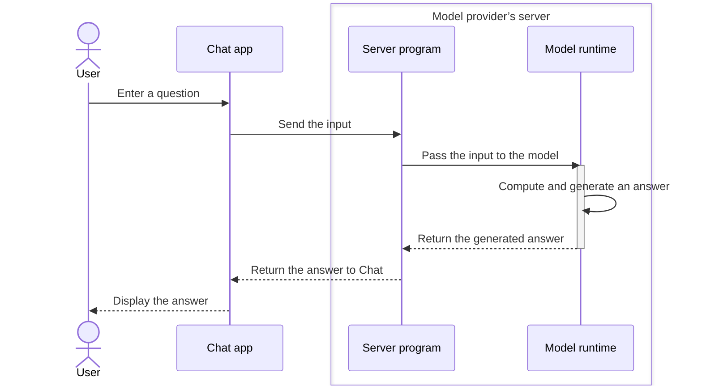
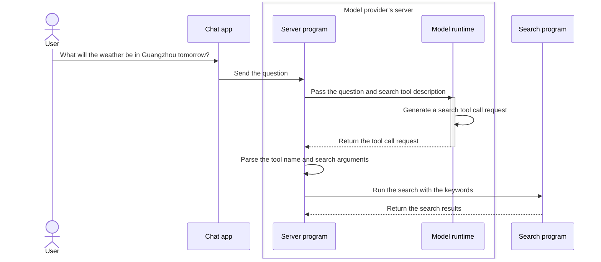

Let us continue with the weather example. As explained in [2.1 How are language models pretrained?](/courses/llm-101/how-language-models-are-trained), without other tools, a language model cannot answer questions about live or proprietary information outside its training data.

A question such as “What will the weather be in Guangzhou tomorrow?” is unlikely to get an accurate answer. But if you use AI Chat products, you may disagree: ChatGPT and DeepSeek can answer weather questions.

Yes, these products can give you weather information.

But as the previous lesson explained, special answers often depend on work done by the product around the model.

To answer questions about current information, the model needs web search or another tool that can retrieve external information. Much like a person, it can receive search results and use them to answer your question.

But a language model is an “automatic text continuation system”. It has no hands. How can it use a tool?


## 1. What exactly is a tool?

In an AI product, a tool is **an external capability that the model can ask a program to execute.**

Web search is one example. A model normally generates answers from the content it receives. With a search tool, it can ask a program to search first and pass the results back.

Many other capabilities can become tools:

| Tool | What can it do? |
| --- | --- |
| Weather lookup | Retrieve weather data for a city from a weather service |
| Calculator | Calculate the result of a supplied expression |
| File reading | Read a specified file and provide its contents to the model |
| Calendar lookup | Retrieve calendar events and provide them to the model |

But having a tool is only the beginning. How does the model use it?

## 2. How does a model use tools?

In the previous lesson, the product placed the user’s input into a specially formatted “letter” and sent it to the server. The server ran the model, received its answer, and returned it to the product for display.

Tool calling follows a similar process. Here is how it works.

### Step 1: Give the model a tool description

Initially, <JimmyNoteAnchor id="001">the model does not know</JimmyNoteAnchor> which tools are available or how to use them. First, we must tell it.

<JimmyNote anchor="001">
  Recent models have already learned how to use some common tools. This step may therefore become simpler and require fewer prompt instructions.
</JimmyNote>

If the product wants the model to use tools, it must include a tool description in the “letter”, alongside the question. Think of it as a list saying: these are the tools you can use now.

For example, we can provide a web search tool called `search_web`. Its description might look like this:

```json
{
  "name": "search_web",  // Tool name
  "description": "Search the web for current information.", // Tool purpose
  "parameters": {
    "type": "object", // Parameter type
    "properties": { // Parameter properties
      "query": {
        "type": "string", // Parameter type
        "description": "The search query." // Parameter description
      }
    },
    "required": ["query"]
  }
}
```

Do not let these fields intimidate you. Focus on three things:

- `name` identifies the tool. Here it is `search_web`, the web search tool.
- `description` explains its purpose. Here it tells the model that the tool searches the web for information.
- `parameters` describes the information needed to use it. This tool requires a `query`: what to search for. As with a search engine, you supply the search keywords.

### Step 2: The model generates a [tool call request](https://platform.claude.com/docs/en/agents-and-tools/tool-use/overview)

After receiving your question and the tool description, the model still works as explained in the first module: it predicts the next likely output and generates text.

But this time, the text looks like this:

```json
<tool_call>{"name":"search_web","arguments":{"query":"Guangzhou weather tomorrow"}}</tool_call>
```

The braces are enclosed in `<tool_call></tool_call>` tags. These tags tell the program that this is a tool call request. The program recognizes the tags, extracts their contents, and puts them into a “letter” like this:

```json
{
  "name": "search_web", // Tool name
  "arguments": {
    "query": "Guangzhou weather forecast for tomorrow" // Search keywords
  }
}
```

The model is now communicating with a program rather than a person. Its output is meant for the program, which is why it uses this special format.

We call this **Tool Calling**. When a tool corresponds to a program function, you will also see the term **Function Calling**.

Has the model used search just by generating this content?

Not yet. So far, it has only generated content. This content is a request in an agreed format: use `search_web` to search for these keywords.

Models that support tool calling can generate such requests from a question and tool descriptions. It is like writing a letter. **Generating the request does not mean the model has opened a webpage and performed a search itself.**

### Step 3: A program executes the tool call

Before this step, let us recall how the model and programs interact after a user enters a message. The Chat product you use is itself a program, which we will call the Chat program:

1. You enter a question and press Send. The Chat program receives your input and passes it to the model provider’s server.
2. The server also runs a program, which we will call the server program. It passes the information to the model. Running the model is also running a program, which we will call the model runtime.
3. The model runtime receives the information, performs calculations, and generates an answer. It returns the answer to the server program, which sends it to the Chat program. The Chat program then displays it to you.

As a diagram, this looks roughly like this:


Back in the tool calling flow, when the model generates a tool call request, the server program sends it to another program, such as a search program, instead of returning that text to Chat. In other words, <JimmyNoteAnchor id="002">a program, not the model</JimmyNoteAnchor>, connects to the search service, sends keywords, and retrieves webpage content.

<JimmyNote anchor="002">
  Think of the model as filling in a task form. The product’s program receives the form and follows its instructions. A form that says “check the weather” does not mean the weather has already been checked.
</JimmyNote>

The search program receives the query, finds tomorrow’s weather in Guangzhou, and returns the result to the server program. It also uses a specially formatted “letter”:

```json
{
  "forecast": "Light rain", // Forecast: light rain
  "temperature_range": "23-28 C", // Temperature range: 23 to 28 °C
}
```

This information then goes back to the server program. The overall flow looks like this:



### Step 4: Give the result back to the model to continue answering

After receiving the search result, the server program sends it to the model together with the message history:

```json
{
  "messages": [
    {
      "role": "user", // Message role: user
      "content": "What will the weather be in Guangzhou tomorrow?" // The user’s question
    },
    {
      "role": "assistant", // Message role: model
      "content": null, // Generated content: empty. The model requested a tool call instead of answering.
      "tool_calls": [
        {
          "type": "function",
          "function": {
            "name": "search_web",
            "arguments": "{\"query\":\"What will the weather be in Guangzhou tomorrow?\"}"
          }
        }
      ]
    },
    {
      "role": "tool", // Message role: tool
      "content": "{\"forecast\":\"Light rain\",\"temperature_range\":\"23-28 C\"}" // Tool result: tomorrow’s Guangzhou forecast is light rain, 23 to 28 °C.
    }
  ]
}
```

Do not worry about this large block of content. It has just three parts:

- The user’s question.
- The tool call request generated by the model.
- The result returned by the tool.

The model then continues its answer from these three parts and returns it to the server program. The server passes it to Chat, which extracts the relevant content from the letter and displays it:

<Chat>
<ChatMessage from="user">
What will the weather be in Guangzhou tomorrow?
</ChatMessage>

<ChatMessage from="assistant">
<ChatToolCall name="search_web" title="Search the web" defaultOpen={true}>
**Call arguments**

```json
{
  "query": "Guangzhou weather forecast for tomorrow"
}
```

**Returned result**

```json
{
  "forecast": "Light rain",
  "temperature_range": "23-28 C"
}
```
</ChatToolCall>

According to the forecast, Guangzhou will have light rain tomorrow, with temperatures around 23 to 28 °C. Remember to bring an umbrella.
</ChatMessage>
</Chat>

## 5. Why is this useful to understand?

You can now see the distinction between a model generating “I checked Guangzhou’s weather” and a program actually performing a search. “I checked” is itself just generated text.

So when the model says “according to the latest information”, that sentence alone does not prove it searched the web. Check whether the product actually called a tool and which sources it returned.

<KeyTakeaway>
Tools can provide external information, but a tool call does not always guarantee accuracy. Check whether the tool ran, what it returned, and whether the final answer matches the result.
</KeyTakeaway>

Some products add an inline citation marker to the message and show the source with the answer. If you doubt the answer, open the source and inspect the original information. This helps you assess its accuracy and whether external information was actually checked.

<Chat>
<ChatMessage from="user">
What will the weather be in Guangzhou tomorrow?
</ChatMessage>

<ChatMessage from="assistant">
<ChatToolCall name="search_web" title="Search the web" defaultOpen={false}>
**Call arguments**

```json
{
  "query": "Guangzhou weather forecast for tomorrow"
}
```

**Returned result**

```json
{
  "forecast": "Light rain",
  "temperature_range": "23-28 C"
}
```
</ChatToolCall>

According to the forecast, Guangzhou will have light rain tomorrow, with temperatures around 23 to 28 °C. Remember to bring an umbrella. <InlineCitation url="https://www.weather.com.cn/weather/101280101.shtml" title="Guangzhou weather forecast · China Weather" description="Open the Guangzhou forecast to check the date, temperature, and weather conditions." />
</ChatMessage>
</Chat>


## 6. Achievement challenge

<Achievement
  id="tool-request-vs-execution"
  title="Understand where AI gets the date"
  question="When you ask AI about tomorrow’s weather in Guangzhou, how does it usually know which date tomorrow means?"
  answer="current-date-from-input-or-tool"
  explanation="The model knows that tomorrow is the day after today. Training data alone does not tell it the date when you ask. The product can include the current date and time zone in its messages, or get the current time through a tool. This information identifies the date that tomorrow refers to."
  takeaway="Tomorrow needs a current date and time zone as a reference. These can come from the product’s context or from a tool."
>
  <AchievementOption value="date-updated-in-training">
    The model memorized the date during training and updates it automatically every day, so it always knows today’s date.
  </AchievementOption>
  <AchievementOption value="current-date-from-input-or-tool">
    The product supplies the current date and time zone in the messages, or gets the current time through a tool, then determines tomorrow’s date.
  </AchievementOption>
  <AchievementOption value="word-meaning-is-enough">
    Understanding the word tomorrow is enough for the model to know its exact date.
  </AchievementOption>
</Achievement>
