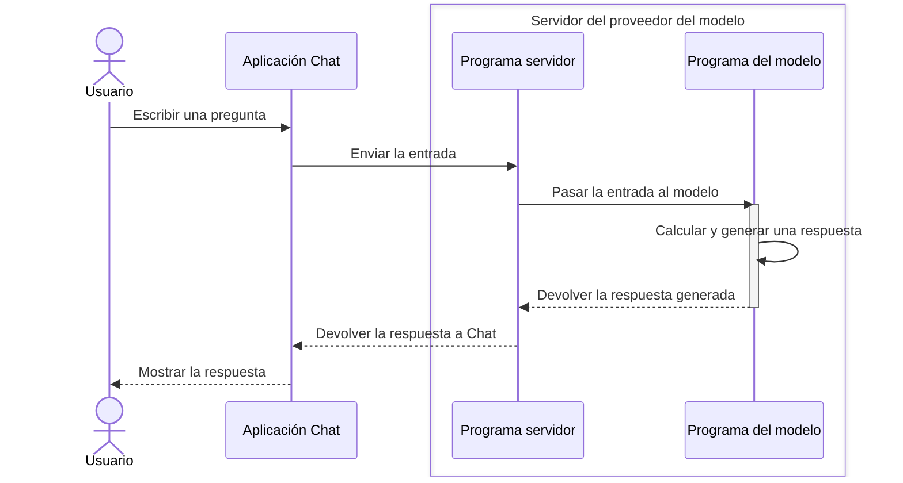
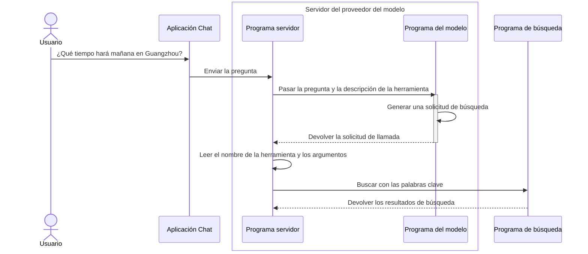

Sigamos con el ejemplo del tiempo. Como expliqué en [2.1 ¿Cómo se preentrenan los modelos?](/es/courses/llm-101/how-language-models-are-trained), sin otras herramientas, un modelo no puede responder sobre información en tiempo real o privada que no figure en sus datos de entrenamiento.

Una pregunta como «¿Qué tiempo hará mañana en Guangzhou?» probablemente no obtenga una respuesta precisa. Pero, si usas productos AI Chat, quizá discrepes: ChatGPT y DeepSeek sí responden sobre el tiempo.

Es cierto: esos productos pueden darte información meteorológica.

Pero, como vimos antes, algunas respuestas dependen de funciones que el producto añade alrededor del modelo.

Para responder sobre información actual, el modelo necesita búsqueda web u otra herramienta que obtenga datos externos. Como una persona, recibe resultados de búsqueda y los usa para contestar.

Pero un modelo de lenguaje es un «sistema automático que continúa texto». No tiene manos. ¿Cómo usa herramientas?


## 1. ¿Qué es exactamente una herramienta?

En un producto de IA, una herramienta es **una capacidad externa que el modelo puede pedir a un programa que ejecute.**

La búsqueda web es un ejemplo. Normalmente, el modelo responde a partir del contenido recibido. Con una herramienta de búsqueda, puede pedir al programa que busque primero y le entregue los resultados.

Muchas otras capacidades pueden convertirse en herramientas:

| Herramienta | ¿Qué puede hacer? |
| --- | --- |
| Consulta del tiempo | Obtener datos meteorológicos de una ciudad desde un servicio especializado |
| Calculadora | Calcular el resultado de una expresión recibida |
| Lectura de archivos | Leer un archivo concreto y entregar su contenido al modelo |
| Consulta de calendario | Consultar eventos y entregar el resultado al modelo |

Pero tener una herramienta no basta. ¿Cómo la usa el modelo?

## 2. ¿Cómo usa herramientas el modelo?

En la lección anterior, el producto colocaba la entrada en una «carta» con un formato especial y la enviaba al servidor. Este ejecutaba el modelo y devolvía su respuesta al producto para mostrarla.

La llamada a herramientas sigue un proceso parecido. Veamos los pasos.

### Paso 1: dar al modelo una descripción de la herramienta

Al principio, <JimmyNoteAnchor id="001">el modelo no sabe</JimmyNoteAnchor> qué herramientas hay ni cómo usarlas. Primero debemos decírselo.

<JimmyNote anchor="001">
  Los modelos recientes ya han aprendido a usar algunas herramientas comunes. Por eso este paso podría simplificarse y necesitar menos instrucciones.
</JimmyNote>

Para que el modelo use herramientas, el producto debe añadir una descripción a la «carta», junto a la pregunta. Es como darle una lista: estas son las herramientas que puedes usar ahora.

Por ejemplo, le ofrecemos una herramienta de búsqueda web llamada `search_web`. Su descripción sería similar a esta:

```json
{
  "name": "search_web",  // Nombre de la herramienta
  "description": "Search the web for current information.", // Función de la herramienta
  "parameters": {
    "type": "object", // Tipo del parámetro
    "properties": { // Propiedades del parámetro
      "query": {
        "type": "string", // Tipo del parámetro
        "description": "The search query." // Descripción del parámetro
      }
    },
    "required": ["query"]
  }
}
```

No te asustes por los campos. Solo necesitas entender tres:

- `name` identifica la herramienta. Aquí es `search_web`, la herramienta de búsqueda web.
- `description` explica para qué sirve. Aquí indica que busca información en Internet.
- `parameters` describe la información necesaria para usarla. Aquí se requiere una `query`: qué se quiere buscar. Como en un buscador, introduces las palabras clave.

### Paso 2: el modelo genera una [solicitud de llamada a herramienta](https://platform.claude.com/docs/en/agents-and-tools/tool-use/overview)

Tras recibir la pregunta y la descripción, el modelo sigue funcionando como explicamos en el primer módulo: predice la siguiente salida probable y genera texto.

Pero esta vez el texto tiene este aspecto:

```json
<tool_call>{"name":"search_web","arguments":{"query":"Guangzhou weather tomorrow"}}</tool_call>
```

Las llaves están rodeadas por las etiquetas `<tool_call></tool_call>`. Indican al programa que es una solicitud de llamada a herramienta. El programa reconoce las etiquetas, extrae su contenido y lo coloca en una «carta» como esta:

```json
{
  "name": "search_web", // Nombre de la herramienta
  "arguments": {
    "query": "Guangzhou weather forecast for tomorrow" // Palabras clave de búsqueda
  }
}
```

Ahora el modelo se comunica directamente con un programa, no con una persona. Por eso escribe en un formato especial destinado al programa.

Este proceso se llama **Tool Calling**, o llamada a herramientas. Si la herramienta corresponde a una función del programa, también verás el término **Function Calling**, o llamada a funciones.

¿Generar este contenido significa que el modelo ya ha usado la búsqueda?

Todavía no. Hasta aquí solo ha generado contenido. Ese contenido es una solicitud con el formato acordado: usar `search_web` para buscar estas palabras clave.

Los modelos compatibles pueden generar esas solicitudes a partir de la pregunta y las descripciones. Es como escribir una carta. **Generar la solicitud no significa que el modelo haya abierto por sí mismo una página y realizado la búsqueda.**

### Paso 3: el programa ejecuta la llamada

Antes de este paso, recordemos cómo interactúan el modelo y los programas tras recibir una entrada. El producto Chat que usas es un programa; lo llamaremos programa Chat:

1. Escribes una pregunta y pulsas Enviar. El programa Chat recibe la entrada y la pasa al servidor del proveedor del modelo.
2. En el servidor también se ejecuta un programa, que llamaremos programa servidor. Este pasa la información al modelo. Ejecutar el modelo también supone ejecutar un programa, que llamaremos programa de ejecución del modelo.
3. Este último recibe la información, calcula y genera una respuesta. La devuelve al programa servidor, que la envía al programa Chat. Finalmente, Chat te la muestra.

En un diagrama, sería así:


Volvamos a la llamada a herramientas. Cuando el modelo genera una solicitud, el programa servidor la envía a otro programa, como el de búsqueda, en vez de devolver ese texto a Chat. Por tanto, quien se conecta al servicio, envía palabras clave y obtiene páginas es <JimmyNoteAnchor id="002">el programa, no el modelo</JimmyNoteAnchor>.

<JimmyNote anchor="002">
  Imagina que el modelo rellena una orden de trabajo. El programa del producto la recibe y sigue sus instrucciones. Que la orden diga «consulta el tiempo» no significa que ya se haya consultado.
</JimmyNote>

El programa de búsqueda recibe la consulta, encuentra el tiempo de mañana en Guangzhou y devuelve el resultado al programa servidor. También usa una «carta» con un formato especial:

```json
{
  "forecast": "Light rain", // Pronóstico: lluvia ligera
  "temperature_range": "23-28 C", // Temperaturas: de 23 a 28 °C
}
```

Esa información vuelve al programa servidor. El proceso general es este:



### Paso 4: devolver el resultado al modelo para seguir respondiendo

El programa servidor recibe el resultado y lo envía al modelo junto con el historial de mensajes:

```json
{
  "messages": [
    {
      "role": "user", // Rol del mensaje: usuario
      "content": "¿Qué tiempo hará mañana en Guangzhou?" // Pregunta del usuario
    },
    {
      "role": "assistant", // Rol del mensaje: modelo
      "content": null, // Contenido generado: vacío. El modelo solicita una llamada a una herramienta en vez de responder.
      "tool_calls": [
        {
          "type": "function",
          "function": {
            "name": "search_web",
            "arguments": "{\"query\":\"¿Qué tiempo hará mañana en Guangzhou?\"}"
          }
        }
      ]
    },
    {
      "role": "tool", // Rol del mensaje: herramienta
      "content": "{\"forecast\":\"Light rain\",\"temperature_range\":\"23-28 C\"}" // Resultado de la herramienta: lluvia ligera mañana en Guangzhou, de 23 a 28 °C.
    }
  ]
}
```

No te preocupes por este bloque tan grande. Solo tiene tres partes:

- La pregunta del usuario.
- La solicitud de llamada generada por el modelo.
- El resultado que devuelve la herramienta.

El modelo continúa la respuesta a partir de esas tres partes y la devuelve al programa servidor. Este la pasa a Chat, que extrae de la carta el contenido necesario y lo muestra:

<Chat>
<ChatMessage from="user">
¿Qué tiempo hará mañana en Guangzhou?
</ChatMessage>

<ChatMessage from="assistant">
<ChatToolCall name="search_web" title="Buscar en la web" defaultOpen={true}>
**Argumentos de la llamada**

```json
{
  "query": "Guangzhou weather forecast for tomorrow"
}
```

**Resultado devuelto**

```json
{
  "forecast": "Light rain",
  "temperature_range": "23-28 C"
}
```
</ChatToolCall>

Según la previsión, mañana habrá lluvia ligera en Guangzhou, con temperaturas de unos 23 a 28 °C. Recuerda llevar paraguas.
</ChatMessage>
</Chat>

## 5. ¿Para qué sirve entender esto?

Ahora puedes distinguir entre que el modelo genere «He consultado el tiempo de Guangzhou» y que un programa realice una búsqueda. «Lo he consultado» también es solo texto generado.

Por eso, cuando diga «según la información más reciente», esa frase no demuestra que haya buscado en Internet. Comprueba si el producto llamó realmente a una herramienta y qué fuentes devolvió.

<KeyTakeaway>
Las herramientas aportan información externa, pero una llamada no siempre garantiza exactitud. Comprueba si se ejecutó, qué devolvió y si la respuesta final coincide con el resultado.
</KeyTakeaway>

Algunos productos añaden una cita en línea al mensaje y muestran la fuente con la respuesta. Si dudas de su exactitud, abre la fuente y consulta la información original. Así puedes comprobar la respuesta y si realmente se consultaron datos externos.

<Chat>
<ChatMessage from="user">
¿Qué tiempo hará mañana en Guangzhou?
</ChatMessage>

<ChatMessage from="assistant">
<ChatToolCall name="search_web" title="Buscar en la web" defaultOpen={false}>
**Argumentos de la llamada**

```json
{
  "query": "Guangzhou weather forecast for tomorrow"
}
```

**Resultado devuelto**

```json
{
  "forecast": "Light rain",
  "temperature_range": "23-28 C"
}
```
</ChatToolCall>

Según la previsión, mañana habrá lluvia ligera en Guangzhou, con temperaturas de unos 23 a 28 °C. Recuerda llevar paraguas. <InlineCitation url="https://www.weather.com.cn/weather/101280101.shtml" title="Previsión del tiempo de Guangzhou · China Weather" description="Consulta la previsión para comprobar la fecha, la temperatura y las condiciones meteorológicas." />
</ChatMessage>
</Chat>


## 6. Reto

<Achievement
  id="tool-request-vs-execution"
  title="Entender de dónde obtiene la fecha la IA"
  question="Cuando preguntas por el tiempo de mañana en Guangzhou, ¿cómo sabe normalmente la IA a qué fecha se refiere mañana?"
  answer="current-date-from-input-or-tool"
  explanation="El modelo sabe que mañana es el día después de hoy. Pero el entrenamiento no le indica la fecha en que preguntas. El producto puede incluir la fecha actual y la zona horaria en los mensajes, o consultar la hora con una herramienta. Esa información permite determinar la fecha de mañana."
  takeaway="Mañana necesita una fecha actual y una zona horaria como referencia. Pueden venir del contexto del producto o de una herramienta."
>
  <AchievementOption value="date-updated-in-training">
    El modelo memorizó la fecha durante el entrenamiento y la actualiza cada día, así que siempre sabe qué día es hoy.
  </AchievementOption>
  <AchievementOption value="current-date-from-input-or-tool">
    El producto incluye la fecha actual y la zona horaria en los mensajes, o consulta la hora con una herramienta, y así determina la fecha de mañana.
  </AchievementOption>
  <AchievementOption value="word-meaning-is-enough">
    Entender la palabra mañana basta para saber directamente su fecha exacta.
  </AchievementOption>
</Achievement>
