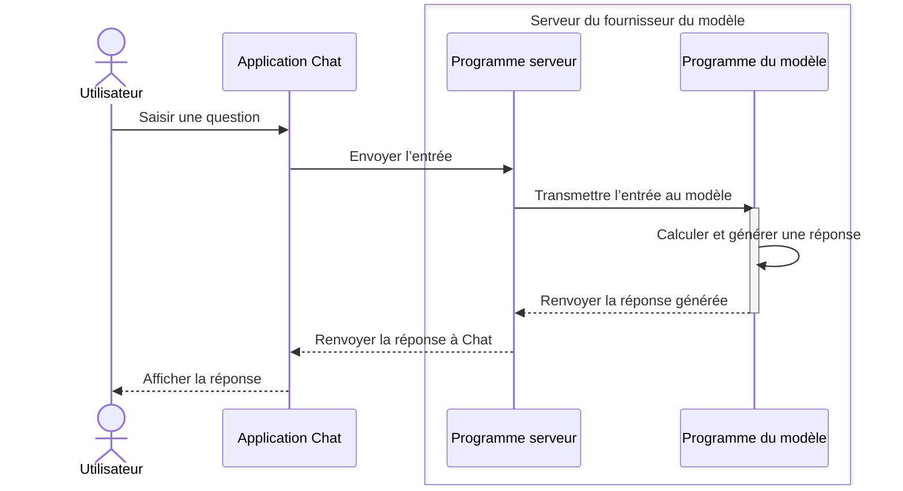
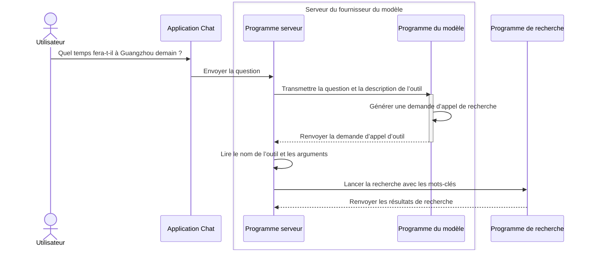

Reprenons l’exemple de la météo. Comme expliqué dans [2.1 Comment les modèles sont-ils préentraînés ?](/fr/courses/llm-101/how-language-models-are-trained), sans outils supplémentaires, un modèle ne peut pas répondre sur des informations en temps réel ou privées absentes de ses données d’entraînement.

Une question comme « Quel temps fera-t-il à Guangzhou demain ? » a donc peu de chances de recevoir une réponse exacte. Pourtant, les utilisateurs de ChatGPT ou de DeepSeek pourraient objecter que ces produits répondent bien aux questions météo.

En effet, ces produits peuvent vous donner la météo.

Mais, comme nous l’avons vu, certaines réponses dépendent des fonctions ajoutées par le produit autour du modèle.

Pour répondre sur l’actualité, le modèle doit disposer d’une recherche web ou d’un autre outil capable d’obtenir des informations externes. Comme une personne, il peut recevoir des résultats de recherche et s’appuyer dessus pour répondre.

Mais un modèle de langage est un « système automatique de continuation du texte ». Il n’a pas de mains. Comment utilise-t-il un outil ?


## 1. Qu’est-ce qu’un outil, exactement ?

Dans un produit IA, un outil est **une capacité externe que le modèle peut demander à un programme d’exécuter.**

La recherche web en est un exemple. Normalement, le modèle répond à partir du contenu reçu. Avec un outil de recherche, il peut demander au programme de chercher d’abord, puis de lui transmettre les résultats.

Bien d’autres capacités peuvent devenir des outils :

| Outil | Que peut-il faire ? |
| --- | --- |
| Consultation météo | Obtenir les données météo d’une ville auprès d’un service spécialisé |
| Calculatrice | Calculer le résultat d’une expression fournie |
| Lecture de fichier | Lire un fichier donné et transmettre son contenu au modèle |
| Consultation du calendrier | Rechercher des événements et transmettre le résultat au modèle |

Mais disposer d’un outil ne suffit pas. Comment le modèle s’en sert-il ?

## 2. Comment le modèle utilise-t-il les outils ?

Dans la leçon précédente, le produit plaçait l’entrée dans une « lettre » au format particulier, puis l’envoyait au serveur. Celui-ci exécutait le modèle et renvoyait sa réponse au produit pour l’afficher.

L’appel d’outil suit un processus semblable. Voici les étapes.

### Étape 1 : fournir une description de l’outil

Au départ, <JimmyNoteAnchor id="001">le modèle ne sait pas</JimmyNoteAnchor> quels outils sont disponibles ni comment les utiliser. Il faut d’abord le lui dire.

<JimmyNote anchor="001">
  Les modèles récents ont déjà appris à utiliser certains outils courants. Cette étape peut donc devenir plus simple et nécessiter moins d’instructions.
</JimmyNote>

Pour permettre l’usage d’un outil, le produit ajoute sa description à la « lettre », en plus de la question. C’est comme donner au modèle une liste : voici les outils disponibles maintenant.

Par exemple, nous proposons un outil de recherche web nommé `search_web`. Sa description ressemble à ceci :

```json
{
  "name": "search_web",  // Nom de l’outil
  "description": "Search the web for current information.", // Rôle de l’outil
  "parameters": {
    "type": "object", // Type du paramètre
    "properties": { // Propriétés du paramètre
      "query": {
        "type": "string", // Type du paramètre
        "description": "The search query." // Description du paramètre
      }
    },
    "required": ["query"]
  }
}
```

Ne vous laissez pas impressionner par les champs. Retenez-en trois :

- `name` est le nom de l’outil. Ici, c’est `search_web`, l’outil de recherche web.
- `description` explique son rôle. Elle indique ici que l’outil recherche des informations sur le web.
- `parameters` décrit les informations à fournir. Ici, il faut une `query`, c’est-à-dire ce qu’il faut chercher. Comme dans un moteur de recherche, vous indiquez les mots-clés.

### Étape 2 : le modèle génère une [demande d’appel d’outil](https://platform.claude.com/docs/en/agents-and-tools/tool-use/overview)

Après réception de la question et de la description, le modèle fonctionne toujours comme dans le premier module : il prédit la suite probable et génère du texte.

Mais cette fois, le texte ressemble à ceci :

```json
<tool_call>{"name":"search_web","arguments":{"query":"Guangzhou weather tomorrow"}}</tool_call>
```

Les accolades sont entourées des balises `<tool_call></tool_call>`. Elles indiquent au programme qu’il s’agit d’une demande d’appel d’outil. Le programme reconnaît les balises, extrait leur contenu et le place dans une « lettre » comme celle-ci :

```json
{
  "name": "search_web", // Nom de l’outil
  "arguments": {
    "query": "Guangzhou weather forecast for tomorrow" // Mots-clés de recherche
  }
}
```

Le modèle communique alors directement avec un programme, pas avec une personne. Le contenu est destiné au programme, d’où ce format particulier.

Ce processus s’appelle **Tool Calling**, ou appel d’outil. Lorsque l’outil correspond à une fonction du programme, on parle aussi de **Function Calling**, ou appel de fonction.

Le modèle a-t-il déjà utilisé la recherche en produisant ce contenu ?

Pas encore. Jusqu’ici, il a seulement généré du contenu. Cette fois, il s’agit d’une demande au format convenu : utiliser `search_web` pour chercher ces mots-clés.

Les modèles compatibles peuvent générer ces demandes à partir des questions et des descriptions d’outils. C’est comme écrire une lettre. **Produire cette demande ne signifie pas que le modèle a lui-même ouvert une page et effectué la recherche.**

### Étape 3 : le programme exécute l’appel

Rappelons d’abord les échanges entre le modèle et les programmes après une saisie. Le produit Chat que vous utilisez est lui-même un programme, que nous appellerons programme Chat :

1. Vous saisissez une question et cliquez sur Envoyer. Le programme Chat reçoit l’entrée et la transmet au serveur du fournisseur.
2. Un autre programme s’exécute sur le serveur : le programme serveur. Il transmet les informations au modèle. L’exécution du modèle passe elle aussi par un programme, que nous appellerons programme d’exécution du modèle.
3. Ce dernier reçoit les informations, effectue les calculs et génère une réponse. Il la transmet au programme serveur, qui la renvoie au programme Chat. Chat vous l’affiche ensuite.

Sous forme de schéma, cela donne ceci :


Revenons à l’appel d’outil. Quand le modèle produit une demande, le programme serveur la transmet à un autre programme, par exemple celui de recherche, au lieu de la renvoyer à Chat. C’est donc <JimmyNoteAnchor id="002">le programme, pas le modèle</JimmyNoteAnchor>, qui se connecte au service, envoie les mots-clés et récupère les pages.

<JimmyNote anchor="002">
  Imaginez que le modèle remplit une fiche de tâche. Le programme du produit reçoit cette fiche et suit ses instructions. Une fiche indiquant « vérifier la météo » ne signifie pas que la vérification a déjà eu lieu.
</JimmyNote>

Le programme de recherche reçoit la requête, trouve la météo de Guangzhou pour demain et renvoie le résultat au programme serveur. Il utilise lui aussi une « lettre » au format particulier :

```json
{
  "forecast": "Light rain", // Prévision : pluie légère
  "temperature_range": "23-28 C", // Températures : de 23 à 28 °C
}
```

Ces informations reviennent ensuite au programme serveur. Le processus général est le suivant :



### Étape 4 : rendre le résultat au modèle pour poursuivre la réponse

Le programme serveur transmet alors le résultat de recherche au modèle, avec l’historique des messages :

```json
{
  "messages": [
    {
      "role": "user", // Rôle du message : utilisateur
      "content": "Quel temps fera-t-il à Guangzhou demain ?" // Question de l’utilisateur
    },
    {
      "role": "assistant", // Rôle du message : modèle
      "content": null, // Contenu généré : vide. Le modèle demande un appel d’outil au lieu de répondre.
      "tool_calls": [
        {
          "type": "function",
          "function": {
            "name": "search_web",
            "arguments": "{\"query\":\"Quel temps fera-t-il à Guangzhou demain ?\"}"
          }
        }
      ]
    },
    {
      "role": "tool", // Rôle du message : outil
      "content": "{\"forecast\":\"Light rain\",\"temperature_range\":\"23-28 C\"}" // Résultat de l’outil : pluie légère demain à Guangzhou, de 23 à 28 °C.
    }
  ]
}
```

Ce grand bloc ne doit pas vous inquiéter. Il comporte seulement trois parties :

- La question de l’utilisateur.
- La demande d’appel d’outil générée par le modèle.
- Le résultat renvoyé par l’outil.

À partir de ces trois éléments, le modèle poursuit sa réponse et la renvoie au programme serveur. Celui-ci la transmet à Chat, qui extrait le contenu utile de la lettre et l’affiche :

<Chat>
<ChatMessage from="user">
Quel temps fera-t-il à Guangzhou demain ?
</ChatMessage>

<ChatMessage from="assistant">
<ChatToolCall name="search_web" title="Rechercher sur le web" defaultOpen={true}>
**Arguments de l’appel**

```json
{
  "query": "Guangzhou weather forecast for tomorrow"
}
```

**Résultat renvoyé**

```json
{
  "forecast": "Light rain",
  "temperature_range": "23-28 C"
}
```
</ChatToolCall>

Selon les prévisions, il pleuvra légèrement demain à Guangzhou, avec des températures d’environ 23 à 28 °C. Pensez à prendre un parapluie.
</ChatMessage>
</Chat>

## 5. À quoi sert cette compréhension ?

Vous voyez maintenant la différence entre un modèle qui écrit « J’ai vérifié la météo de Guangzhou » et un programme qui effectue réellement une recherche. « J’ai vérifié » reste du texte généré.

Ainsi, la phrase « d’après les dernières informations » ne prouve pas une recherche sur Internet. Vérifiez si le produit a vraiment appelé un outil et quelles sources il a obtenues.

<KeyTakeaway>
Les outils apportent des informations externes, mais leur appel ne garantit pas toujours l’exactitude. Vérifiez leur exécution, leur résultat et la cohérence de la réponse finale avec ce résultat.
</KeyTakeaway>

Certains produits ajoutent une citation dans le message et affichent la source avec la réponse. En cas de doute, ouvrez-la pour consulter l’information originale. Cela aide à vérifier la réponse et à déterminer si des informations externes ont réellement été consultées.

<Chat>
<ChatMessage from="user">
Quel temps fera-t-il à Guangzhou demain ?
</ChatMessage>

<ChatMessage from="assistant">
<ChatToolCall name="search_web" title="Rechercher sur le web" defaultOpen={false}>
**Arguments de l’appel**

```json
{
  "query": "Guangzhou weather forecast for tomorrow"
}
```

**Résultat renvoyé**

```json
{
  "forecast": "Light rain",
  "temperature_range": "23-28 C"
}
```
</ChatToolCall>

Selon les prévisions, il pleuvra légèrement demain à Guangzhou, avec des températures d’environ 23 à 28 °C. Pensez à prendre un parapluie. <InlineCitation url="https://www.weather.com.cn/weather/101280101.shtml" title="Prévisions météo de Guangzhou · China Weather" description="Consultez les prévisions pour vérifier la date, la température et les conditions météo." />
</ChatMessage>
</Chat>


## 6. Défi

<Achievement
  id="tool-request-vs-execution"
  title="Comprendre l’origine de la date pour l’IA"
  question="Quand vous demandez la météo de Guangzhou pour demain, comment l’IA sait-elle généralement de quelle date il s’agit ?"
  answer="current-date-from-input-or-tool"
  explanation="Le modèle sait que demain est le jour après aujourd’hui. Mais ses données d’entraînement ne lui donnent pas la date de votre question. Le produit peut inclure la date actuelle et le fuseau horaire dans les messages, ou obtenir l’heure avec un outil. Ces informations permettent de déterminer la date de demain."
  takeaway="Demain exige une date actuelle et un fuseau horaire de référence. Ils peuvent venir du contexte fourni par le produit ou d’un outil."
>
  <AchievementOption value="date-updated-in-training">
    Le modèle a mémorisé la date pendant l’entraînement et la met à jour chaque jour, donc il connaît toujours la date actuelle.
  </AchievementOption>
  <AchievementOption value="current-date-from-input-or-tool">
    Le produit fournit la date actuelle et le fuseau horaire dans les messages, ou obtient l’heure par un outil, puis détermine la date de demain.
  </AchievementOption>
  <AchievementOption value="word-meaning-is-enough">
    Comprendre le sens du mot demain suffit pour en connaître la date exacte.
  </AchievementOption>
</Achievement>
