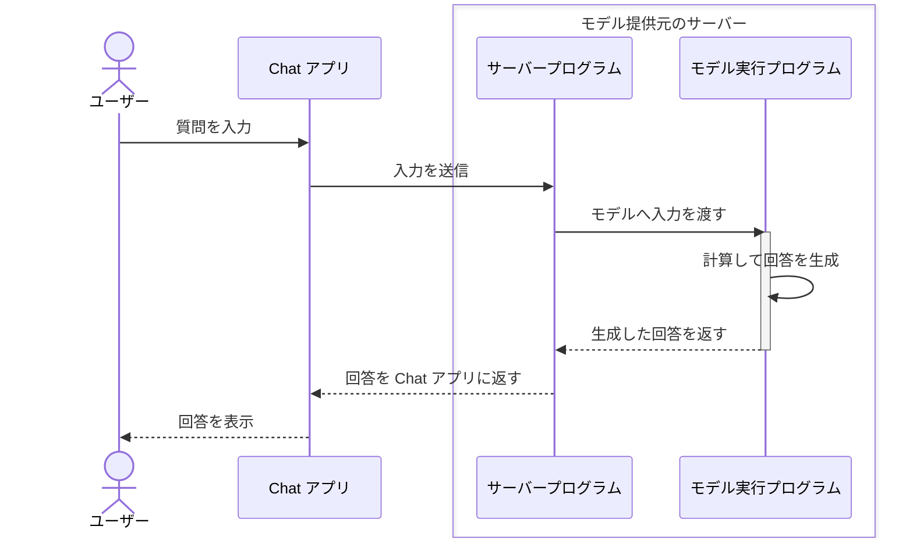
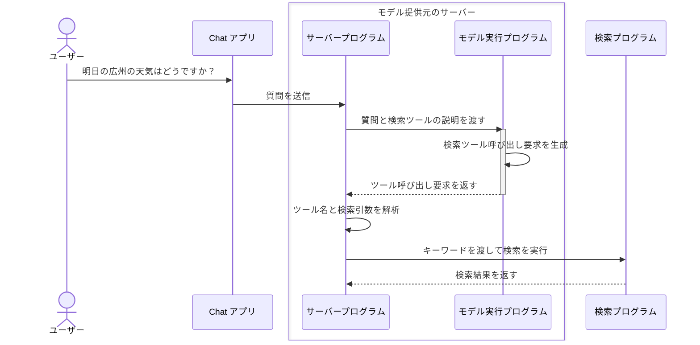

引き続き、天気の質問を例に説明します。[2.1 モデルはどのように事前学習するのか？](/ja/courses/llm-101/how-language-models-are-trained)で述べたように、ほかのツールを使わなければ、モデルは学習データにない最新情報や非公開の情報には答えられません。

「明日の広州の天気はどうですか？」といった質問に、正確に答えるのは難しいでしょう。でも AI Chat 製品を使った人は、ChatGPT や DeepSeek は天気の質問に答えられる、と反論したくなるかもしれません。

確かに、こうした製品から天気の情報を得られます。

ただし前の授業で説明したように、特定の質問に答えられるのは、モデルの周りで製品がさまざまな工夫をしているためです。

最新情報に答えるには、ウェブ検索など、外部情報を取得できるツールを使えるようにすることが大切です。人と同じように、検索結果を得て、その内容に基づいて質問に答えます。

でも、大規模言語モデルは「自動で文章の続きを作る仕組み」です。手もないのに、どうやってツールを使うのでしょうか？


## 1. Tool とは何か？

Tool は「道具」という意味です。AI 製品では、**モデルがプログラムに実行を依頼できる外部の機能**と考えられます。

ウェブ検索はその一つです。モデルは通常、受け取った内容から回答を生成します。検索ツールを接続すると、先にプログラムへ検索を依頼し、結果を受け取れるようになります。

検索以外にも、多くの機能をツールにできます。

| ツール | できること |
| --- | --- |
| 天気の照会 | 天気サービスから指定した都市の天気データを取得する |
| 計算機 | 渡された計算式の結果を求める |
| ファイルの読み取り | 指定したファイルを読み、内容をモデルに渡す |
| カレンダーの照会 | 予定を調べ、結果をモデルに渡す |

では、ツールがあるとして、モデルはどう使うのでしょうか？

## 2. モデルはどうやってツールを使うのか？

前の授業では、製品が入力を決まった書式の「手紙」に入れ、サーバーへ送ると説明しました。サーバーがモデルを実行し、生成された回答を製品に返して、ユーザーに表示します。

ツール呼び出しも似た流れです。全体を見てみましょう。

### 手順 1：モデルにツールの説明を渡す

最初は、使えるツールや使い方を<JimmyNoteAnchor id="001">モデルは知りません</JimmyNoteAnchor>。まず、それを伝える必要があります。

<JimmyNote anchor="001">
  ただし、新しいモデルは一部の一般的なツールの使い方をすでに学んでいます。そのため、この手順は簡単になり、必要なプロンプトも減るかもしれません。
</JimmyNote>

ツールを使わせたい製品は、質問に加えてツールの説明を「手紙」に入れます。「今はこれらのツールを使えます」という一覧を渡すようなものです。

たとえば、`search_web` というウェブ検索ツールを提供するとします。説明は次のようになります。

```json
{
  "name": "search_web",  // ツール名
  "description": "Search the web for current information.", // ツールの用途
  "parameters": {
    "type": "object", // 引数の型
    "properties": { // 引数のプロパティ
      "query": {
        "type": "string", // 引数の型
        "description": "The search query." // 引数の説明
      }
    },
    "required": ["query"]
  }
}
```

項目の多さに驚く必要はありません。三つだけ理解しましょう。

- `name` はツールの名前です。ここではウェブ検索ツールの `search_web` です。
- `description` は用途です。ここでは、ウェブ上の情報を検索できるとモデルに伝えます。
- `parameters` は使用時に指定する情報です。ここでは検索内容を表す `query` が必要です。検索エンジンと同じように、検索したいキーワードを入れます。

### 手順 2：モデルが[ツール呼び出し要求](https://platform.claude.com/docs/en/agents-and-tools/tool-use/overview)を生成する

質問とツールの説明を受け取っても、モデルの動作は最初のモジュールで説明したものと同じです。次に来そうな出力を予測し、テキストを生成します。

ただし、今回は次のようなテキストを出力します。

```json
<tool_call>{"name":"search_web","arguments":{"query":"Guangzhou weather tomorrow"}}</tool_call>
```

波括弧の前後に `<tool_call></tool_call>` タグがあります。これはツール呼び出し要求であることをプログラムに伝えます。プログラムはタグを認識し、中の内容を取り出して、次のような「手紙」に入れます。

```json
{
  "name": "search_web", // ツール名
  "arguments": {
    "query": "Guangzhou weather forecast for tomorrow" // 検索キーワード
  }
}
```

このときモデルは、人ではなくプログラムと直接やり取りしています。出力はプログラム向けなので、この特別な形式を使うのです。

これを **Tool Calling（ツール呼び出し）** と呼びます。ツールがプログラムの関数に対応する場合、**Function Calling（関数呼び出し）** とも呼ばれます。

この内容を生成しただけで、検索ツールを使ったことになるのでしょうか？

まだです。ここまでモデルが行ったのは、あくまで内容の生成です。今回は「`search_web` でこのキーワードを検索してください」という、決まった形式の要求を生成しました。

ツール呼び出しに対応するモデルは、質問とツールの説明から、このような要求を生成できます。手紙を書いたようなものです。**要求を生成しただけで、モデル自身がウェブページを開いて検索したわけではありません。**

### 手順 3：プログラムがツール呼び出しを実行する

その前に、入力後のモデルとプログラムのやり取りを振り返りましょう。使っている Chat 製品も、本質的にはプログラムです。ここでは Chat プログラムと呼びます。

1. 質問を入力して送信すると、Chat プログラムが入力を受け取り、モデル提供元のサーバーに渡します。
2. サーバーにもプログラムが動いています。これをサーバープログラムと呼びます。受け取った情報をモデルへ渡します。モデルの実行もプログラムの実行なので、ここではモデル実行プログラムと呼びます。
3. モデル実行プログラムは計算して回答を生成し、サーバープログラムに返します。サーバープログラムは Chat プログラムに返し、Chat プログラムがユーザーに表示します。

図にすると、おおよそ次のようになります。


ツール呼び出しに戻りましょう。モデルが要求を生成すると、サーバープログラムはその文章を Chat に返さず、検索プログラムなどの別のプログラムに渡します。検索サービスへの接続、キーワードの送信、ページの取得を実際に行うのは、<JimmyNoteAnchor id="002">モデルではなくプログラム</JimmyNoteAnchor>です。

<JimmyNote anchor="002">
  モデルが作業依頼票を書き、製品のプログラムが受け取って作業する、と考えてください。「天気を調べて」と書かれた依頼票があっても、調査が終わったとは限りません。
</JimmyNote>

検索プログラムは問い合わせを受け取り、明日の広州の天気を調べ、結果をサーバープログラムに返します。その結果も特別な形式の「手紙」で返します。

```json
{
  "forecast": "Light rain", // 天気予報：小雨
  "temperature_range": "23-28 C", // 気温の範囲：23〜28 ℃
}
```

その情報がサーバープログラムに戻ります。全体の流れは次のようになります。



### 手順 4：結果をモデルに戻し、回答を続ける

サーバープログラムは検索結果を受け取ると、過去のメッセージと一緒にモデルへ渡します。

```json
{
  "messages": [
    {
      "role": "user", // メッセージの役割：ユーザー
      "content": "明日の広州の天気はどうですか？" // ユーザーの質問内容
    },
    {
      "role": "assistant", // メッセージの役割：モデル
      "content": null, // 生成内容：空。回答ではなくツール呼び出し要求を生成しています。
      "tool_calls": [
        {
          "type": "function",
          "function": {
            "name": "search_web",
            "arguments": "{\"query\":\"明日の広州の天気はどうですか？\"}"
          }
        }
      ]
    },
    {
      "role": "tool", // メッセージの役割：ツール
      "content": "{\"forecast\":\"Light rain\",\"temperature_range\":\"23-28 C\"}" // ツールの結果：明日の広州は小雨、23〜28 ℃。
    }
  ]
}
```

この大きな塊を見て不安になる必要はありません。内容は三つです。

- ユーザーの質問。
- モデルが生成したツール呼び出し要求。
- ツールが返した結果。

モデルはこの三つから回答を続け、サーバープログラムへ返します。サーバーが Chat に渡し、Chat は手紙から必要な内容を取り出して表示します。

<Chat>
<ChatMessage from="user">
明日の広州の天気はどうですか？
</ChatMessage>

<ChatMessage from="assistant">
<ChatToolCall name="search_web" title="ウェブ検索" defaultOpen={true}>
**呼び出し引数**

```json
{
  "query": "Guangzhou weather forecast for tomorrow"
}
```

**返された結果**

```json
{
  "forecast": "Light rain",
  "temperature_range": "23-28 C"
}
```
</ChatToolCall>

予報によると、明日の広州は小雨で、気温はおよそ 23〜28 ℃です。出かけるときは傘を忘れずに。
</ChatMessage>
</Chat>

## 5. この仕組みを知ると何に役立つのか？

ここまでわかれば、「広州の天気を調べました」とモデルが生成することと、プログラムが本当に検索することの違いが見えてきます。「調べました」自体も、生成された文章にすぎません。

そのため、「最新情報によると」という一文だけで、ウェブ検索したと判断してはいけません。製品が実際にツールを呼び出したか、どの情報源が返されたかを確認しましょう。

<KeyTakeaway>
ツールは外部情報を提供できますが、呼び出しただけでは正確さを保証できません。実行されたか、何が返ったか、最終回答が結果に沿っているかを確認する必要があります。
</KeyTakeaway>

一部の製品はメッセージにインライン引用の印を付け、回答と一緒に情報源を表示します。正確さが気になる場合は、情報源を開いて原文を確認できます。回答が正しいか、本当に外部情報を調べたかを判断する助けになります。

<Chat>
<ChatMessage from="user">
明日の広州の天気はどうですか？
</ChatMessage>

<ChatMessage from="assistant">
<ChatToolCall name="search_web" title="ウェブ検索" defaultOpen={false}>
**呼び出し引数**

```json
{
  "query": "Guangzhou weather forecast for tomorrow"
}
```

**返された結果**

```json
{
  "forecast": "Light rain",
  "temperature_range": "23-28 C"
}
```
</ChatToolCall>

予報によると、明日の広州は小雨で、気温はおよそ 23〜28 ℃です。出かけるときは傘を忘れずに。 <InlineCitation url="https://www.weather.com.cn/weather/101280101.shtml" title="広州の天気予報 · 中国天気網" description="広州の予報を開き、日付、気温、天候を確認します。" />
</ChatMessage>
</Chat>


## 6. 達成チャレンジ

<Achievement
  id="tool-request-vs-execution"
  title="AI が日付を知る方法を理解する"
  question="明日の広州の天気を尋ねたとき、AI は通常、明日が何日かをどう判断しますか？"
  answer="current-date-from-input-or-tool"
  explanation="モデルは明日が今日の翌日だと理解していますが、学習データだけでは質問時の日付はわかりません。製品が現在の日付とタイムゾーンをメッセージに入れるか、ツールで現在時刻を取得できます。その情報で明日の日付を特定します。"
  takeaway="明日を特定するには、現在の日付とタイムゾーンが必要です。製品が渡すコンテキストやツールの照会から得られます。"
>
  <AchievementOption value="date-updated-in-training">
    モデルは学習中に日付を覚え、その後も毎日自動更新するので、常に今日の日付を知っている。
  </AchievementOption>
  <AchievementOption value="current-date-from-input-or-tool">
    製品がメッセージに現在の日付とタイムゾーンを入れるか、ツールで現在時刻を取得し、明日の日付を判断する。
  </AchievementOption>
  <AchievementOption value="word-meaning-is-enough">
    明日という言葉の意味を理解すれば、具体的な日付もそのままわかる。
  </AchievementOption>
</Achievement>
