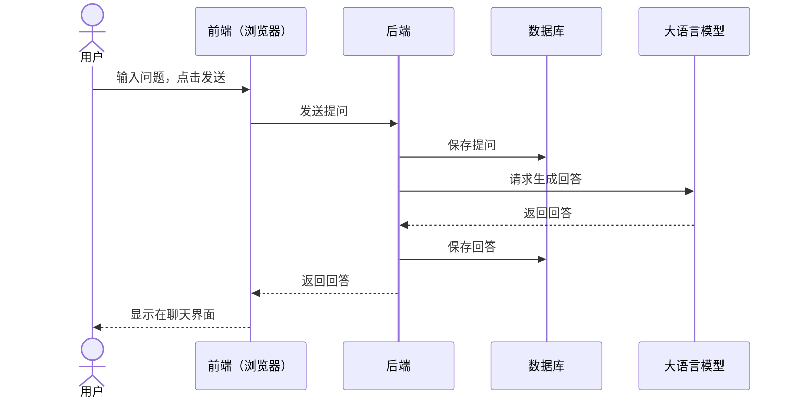

你可能会听过什么「前端」「后端」还有什么「数据库」这些名词，但这些名词背后，到底代表了什么？

## 一、把网站想成一家餐厅

我们可以将一个网站或者应用类比成一家餐厅。

| 餐厅里的部分 | 网站里的对应部分   | 负责什么                                                         |
| ------------ | ------------------ | ---------------------------------------------------------------- |
| 前厅         | 前端（Frontend）   | 引导你点菜。菜做好了，将其从后厨端出来。一般你能看到前厅和服务员 |
| 后厨         | 后端（Backend）    | 接到你点的菜，然后按规则做菜，一般你看不见后厨                   |
| 仓库         | 数据库（Database） | 长期保存食材和记录，随时取用，一般你也看不见                     |

如果我们拿 AI chat 举例，浏览器里的 chat 界面就是「前端」，你可以输入内容，然后点击发送，你输入的信息，会被「后端」接收到，「后端」会将你的提问保存到「数据库」里，同时大语言模型输出结果后，后端会把回答返回给「前端」，同时把回答也保存到「数据库」。浏览器拿到回答，把它显示在聊天界面里，你就看到了 AI 的回复。

把这条链路整理成图，就是下面这样：

整个流程就跟你去餐厅类似，你一般只能看到前厅，和服务员进行交互，所以一般有界面的部分都是「前端」，而看不见的后厨则是「后端」，记录所有数据的是「数据库」。如果你之前看过我们的 LLM 101 课程内容，应该还知道 JSON，前端后端之间的数据传递，一般都会用它，它就像是餐厅里的写的订单。

## 二、前端：你看到以及能交互的

前端是运行在浏览器里的部分。文字、图片、按钮、搜索框等等都是前端。它通常由三种东西组成：

- HTML：页面里有什么，比如标题、文本、按钮。
- CSS：这些东西长什么样，比如颜色、间距、圆角。
- JavaScript：页面怎么响应你的操作，比如点击搜索后发送请求、更新卡片。

下面从左到右分别是仅有 HTML、仅有 HTML+CSS、HTML+CSS+JavaScript 的效果：

<FrontendLayersDemo />

现在你还不需要知道如何写这些代码，只需要理解这些概念就行。但前端有两个特点，你可以动手试试：

- 第一，前端代码会被下载到你的电脑。打开浏览器的开发者工具，你就能看到页面的结构和样式。
- 第二，浏览器里的东西可以被你修改。

你可以照着以下动图教程修改一下试试：

<FrontendInspectorDemo />

## 三、后端：在服务器上做决定

后端是运行在服务器上的程序。服务器可以理解为一台一直开着、专门等别人来请求的电脑。它不出现在你的屏幕上；你每点一次搜索、每提交一次表单，浏览器就把一个**请求（Request）**发给后端，后端处理完，再送回一个**响应（Response）**。

后端一般做这些事：

- 接收请求，读懂用户想要什么。
- 读写数据库，取出或保存资料。
- 需要时调用别的服务，比如 AI API。
- 整理结果，返回给前端。

为什么不能把这些判断放在前端？因为用户可以改浏览器里的代码。后端在服务器上，用户看不到也改不了，所以「哪些数据能返回」必须由后端决定。

## 四、数据库：替网站记住

数据库是长期、有结构地保存资料的系统。网站被用户关掉、再打开，刷新页面，服务器重启，里面的数据都还在。

「有结构」的意思是，资料按固定的列（column）存放。比如一个网站的注册用户表，可以想成这样一张表。你可以把数据库简单理解为一张非常巨大的 Excel 表格。

| id  | username | email            | created_at |
| --- | -------- | ---------------- | ---------- |
| 1   | 小明     | ming@example.com | 2026-11-01 |
| 2   | 小红     | hong@example.com | 2026-11-02 |
| 3   | 阿杰     | jie@example.com  | 2026-11-05 |

## 五、所有网站都是由它们构成的吗？

了解完这些简单的概念后，我们再简单聊下，现在市面上常见的产品的架构是怎样的。

首先，有不少产品不需要单独搭建后端系统，也不需要数据库。比如我的<JimmyNoteAnchor id="001">个人网站</JimmyNoteAnchor>，主要用于展示个人介绍、作品和文章。

<WebsitePreview url="https://jimmywong.dev/en" title="Jimmy 的个人网站">

</WebsitePreview>

<JimmyNote anchor="001">
  对于 GitHub 贡献记录这类外部数据，网站会通过框架提供的服务端能力获取并处理，再展示在页面上。具体怎么实现，我会在后续的课程中详细介绍。
</JimmyNote>

另外，还有一些直接就使用浏览器能力的产品也不需要后端和数据库，比如一些简单的 BMI 计算器等。我们一般会将这类网站称为静态网站，这个我们也会在后续的课程里详细介绍。

那什么时候需要用到后端和数据库？我整理了一个表格，如果你要开发类似的功能，就要了解相关的知识了：

| 功能类型 | 是否需要后端 | 是否需要数据库 |
| -------- | ------------ | -------------- |
| 用户需要登录/注册使用 | ✅           | ✅             |
| 内容需要实时更新（如库存） | ✅           | ✅             |
| 使用历史记录如本网站的成就功能 |   这个要看情况，本网站的成就功能记录实际上是保存在浏览器里的，所以只要不清楚浏览器记录，即使刷新也依然在，这种就不一定需要后端和数据库了。   |
| 数据同步（比如跨设备同步成就记录） | ✅ 如果要跨设备同步成就记录，就需要后端和数据库了        |

