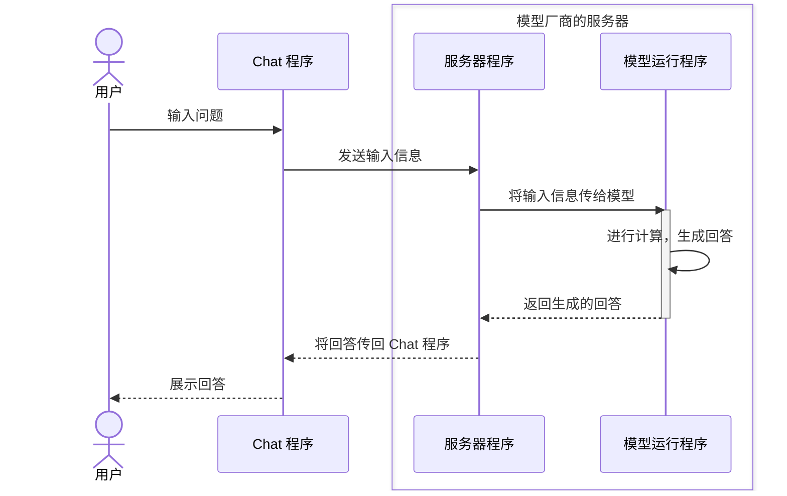
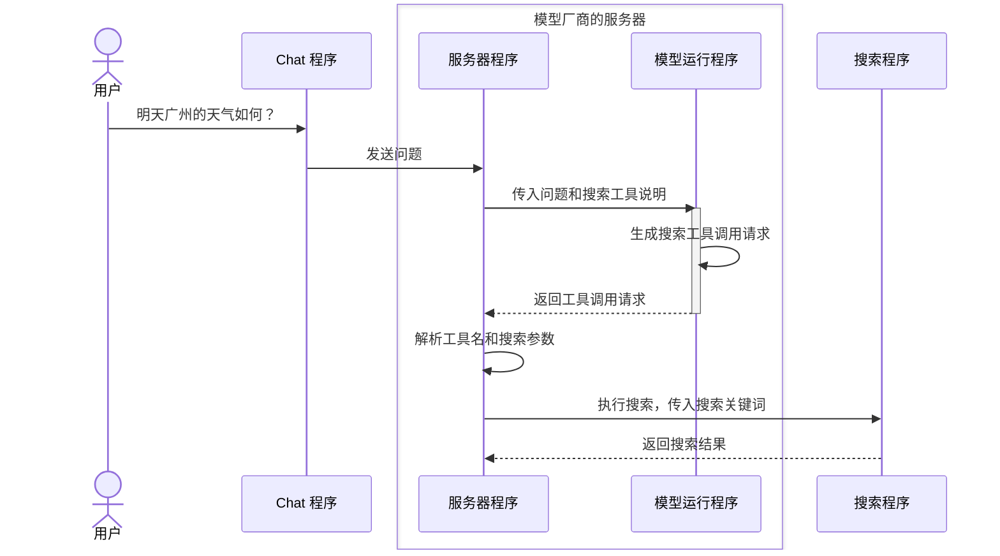

我们继续使用天气的提问作为讲解的例子，正如我在 [2.1 模型是如何预训练的？](/zh/courses/llm-101/how-language-models-are-trained)里讲解的那样，在不使用其他工具的情况下，大语言模型无法回答训练数据之外的实时或专有信息。

像「明天广州的天气如何？」这种问题，大概率是无法回答准确的。但如果你使用过各种 AI Chat 产品，你可能会持反对的意见。不是啊，ChatGPT 或者 DeepSeek 都能回答天气的问题啊。

的确，你能从这些产品中获得天气的答案。

但正如前一章提到的那样，模型之所以能回答一些特殊的问题，实际上是产品上做了不少优化。

要想让大语言模型回答当前最新的信息，关键是让大语言模型能使用网络搜索或其他能获取外部信息的工具。就跟人一样，给它搜索工具，它搜索到结果，得到结果后，再基于结果内容回答你的问题。

但大语言模型就是个「全自动文字接龙系统」啊，它又没有手，它是怎么使用这些工具的呢？


## 一、Tool 到底是什么？

Tool 翻译过来就是「工具」。在 AI 产品里，你可以将它理解为：**模型可以请求程序执行的一项外部能力。**

比如，网络搜索就是一种工具。模型原本只能根据收到的内容生成回答，接入搜索工具后，就可以请求程序先去搜索，再把搜索到的内容交给它。

除了搜索，还有很多能力可以做成工具：

| 工具 | 可以做什么？ |
| --- | --- |
| 天气查询 | 从天气服务获取指定城市的天气数据 |
| 计算器 | 根据传入的算式计算结果 |
| 文件读取 | 读取指定文件，把内容交给模型 |
| 日历查询 | 查询日历里的安排，把结果交给模型 |

但有工具又如何？模型是怎么使用它的呢？

## 二、模型是如何使用工具的？

在上一章中，我们提到用户输入的信息，会被产品填入一个带特殊格式的信里，然后再将其发送到服务器里，服务器运行模型，模型生成回答后，再将其发回给产品，产品再展示给用户。

工具的调用流程也是类似的，整个流程大概是这样的。

### 第一步：先给模型一份工具说明

首先，这些工具如何用，以及有哪些可以用，<JimmyNoteAnchor id="001">模型并不知道</JimmyNoteAnchor>。所以第一步就是先要告诉它。

<JimmyNote anchor="001">
  不过某些通用工具的使用方法，已经被最新的模型学会了，所以这一步，有可能会越来越简洁。不需要塞入那么多的提示词。
</JimmyNote>

如果希望模型使用工具，产品就需要在「信」里，除了提问之外，再附上一份工具说明。你可以将其理解为给模型一张清单，告诉它：你现在可以使用这些工具。

比如，我们给它提供一个叫 `search_web` 的网络搜索工具。它的说明大概是这样的：

```json
{
  "name": "search_web",  // 工具的名字
  "description": "Search the web for current information.", // 工具的用途
  "parameters": {
    "type": "object", // 参数的类型
    "properties": { // 参数的属性
      "query": {
        "type": "string", // 参数的类型
        "description": "The search query." // 参数的描述
      }
    },
    "required": ["query"]
  }
}
```

先不用被这些字段吓到。你只需要看懂三个地方：

- `name` 是工具的名字。这里叫 `search_web`（网络搜索工具）。
- `description` 是工具的用途。这里告诉模型，这个工具可以搜索网络上的信息。
- `parameters` 是使用工具时需要填写的信息。这里需要一个 `query`，也就是要搜索什么。就类似你使用搜索引擎那样，这里填入的是你要搜索的关键词。

### 第二步：模型生成一条[工具调用请求](https://platform.claude.com/docs/en/agents-and-tools/tool-use/overview)

模型收到你的问题和工具说明后，还是跟第一章提到的方式一样，猜测下一个最有可能的结果，输出文本内容。

但此时它输出的文本内容是这样的：

> `<tool_call>{"name":"search_web","arguments":{"query":"Guangzhou weather tomorrow"}}</tool_call>`

可以看到花括号前后有 `<tool_call></tool_call>` 标签包着。这个标签是用来告诉程序，这是一条工具调用请求。然后程序就会识别这个标签，将标签内的内容提取出来，然后填到「信」里，就像这样：

```json
{
  "name": "search_web", // 工具的名字
  "arguments": {
    "query": "Guangzhou weather forecast for tomorrow" // 要搜索的关键词
  }
}
```

你可以理解为，此时模型和程序直接交流，而不是跟人交流，所以它写的东西，就不是给人看的了，而是给程序看的，所以才会写成上面那一段你看不懂的内容。

这个过程我们称它为 **Tool Calling（工具调用）**。如果工具对应的是一个程序函数，你也经常会看到 **Function Calling（函数调用）** 这个说法。

那模型生成一段这样的内容，就算使用了搜索工具了吗？

还没有。到这里，模型做的事情仍然是生成内容，只是这次生成的内容，是一条按约定格式表达的请求：请使用 `search_web`，搜索这些关键词。

支持工具调用的模型，能够根据问题和工具说明生成这类请求。类似写了一封信，**它并没有因为生成了这条请求，就自己打开网页，完成搜索。**

### 第三步：程序执行工具调用

在讲这一步之前，我想简单跟大家一起回忆一下上一讲，当用户输入信息后，模型和程序是如何交互的。你在用的 Chat 产品，本质就是程序（后称为 Chat 程序）：

1. 当你输入问题，点击发送。它收到你的输入，然后将这些输入信息传给模型厂商的服务器。
2. 服务器里也会跑一个程序（后称服务器程序），它负责将收到的信息传给模型，而模型运行其实也是在跑程序（后称模型运行程序）
3. 模型运行程序收到信息后，会进行一系列的计算，然后生成回答，然后将回答传回给服务器程序，服务器程序再将其传回给 Chat 程序，Chat 程序再将其展示给你。

如果整理成图，大概是这样的：


那回到 tool calling 的流程，当模型生成了一条工具调用请求后，服务器程序就不会将这段话发送回 Chat 程序了，而是会将其发给其他的程序。比如搜索工具的程序。也就是说，真正连接搜索服务、发送关键词、获取网页内容的，是<JimmyNoteAnchor id="002">程序，而不是模型</JimmyNoteAnchor>。

<JimmyNote anchor="002">
  你可以将其理解为：模型填好了一张任务单，产品里的程序收到任务单后，按照上面的内容去做事。任务单里写着「去查天气」，不代表天气已经查到了。
</JimmyNote>

收到搜索查询后，搜索程序查到了广州明天的天气，就会把查询结果返回给服务器程序。搜索程序也会使用特殊格式的「信」来返回结果：

```json
{
  "forecast": "Light rain", // 天气预报结果：小雨
  "temperature_range": "23-28 C", // 气温范围结果：23 至 28 ℃
}
```

最后这些信息会再传回给服务器程序，其大致流程是这样的：



### 第四步：把结果交回模型，继续生成回答

接着，服务器程序收到结果后，会将搜索结果和历史的消息也都一同传回给模型：

```json
{
  "messages": [
    {
      "role": "user", // 消息身份：用户
      "content": "明天广州的天气如何？" // 用户的问题内容
    },
    {
      "role": "assistant", // 消息身份：模型
      "content": null, // 模型生成的内容：空。因为没有回答，而是直接生成了工具调用请求。
      "tool_calls": [
        {
          "type": "function",
          "function": {
            "name": "search_web",
            "arguments": "{\"query\":\"广州明天的天气如何？\"}"
          }
        }
      ]
    },
    {
      "role": "tool", // 消息身份：工具
      "content": "{\"forecast\":\"Light rain\",\"temperature_range\":\"23-28 C\"}" // 工具返回的结果：广州明天的天气预报：小雨，23 至 28 ℃。
    }
  ]
}
```

大家看到上面的这一坨内容不用恐惧，实际就是三块：

- 第一块是用户的问题。
- 第二块是模型生成的工具调用请求。
- 第三块是工具返回的结果。

然后模型会根据这三块内容，继续生成回答，返回结果给服务器程序，服务器程序会将信息传回给 Chat 程序，Chat 程序再从信里摘出必要的内容，展示给你：

<Chat>
<ChatMessage from="user">
明天广州的天气如何？
</ChatMessage>

<ChatMessage from="assistant">
<ChatToolCall name="search_web" title="搜索网页" defaultOpen={true}>
**调用参数**

```json
{
  "query": "Guangzhou weather forecast for tomorrow"
}
```

**返回结果**

```json
{
  "forecast": "Light rain",
  "temperature_range": "23-28 C"
}
```
</ChatToolCall>

根据查询到的天气预报，明天广州有小雨，气温约 23 至 28 ℃，出门记得带伞。
</ChatMessage>
</Chat>

## 五、搞懂这个概念有什么用？

理解了上面的过程后，你应该就能发现一个问题：模型生成「我查到了广州的天气」，和程序真的执行了一次搜索，是两回事。「我查了」本身，也只是一段模型生成出来的文字。

所以，当模型告诉你「根据最新信息」时，你不能只看这句话，就认定它已经联网搜索过。你还需要检查产品是否真的调用了工具，以及返回的来源是什么。

<KeyTakeaway>
工具可以为模型提供外部信息，但模型调用了工具，有时并不保证准确性。你还需要检查工具是否执行、返回了什么，以及最终回答是否符合返回的内容。
</KeyTakeaway>

部分产品会在 message 消息里加上一个 inline citation 的标记，在展示回答时，将来源也一并展示出来。如果你对答案的准确性有疑问，可以点击来源，查看原始信息。这会有助于你判断模型的回答是否准确，以及模型是否真的查了外部信息。

<Chat>
<ChatMessage from="user">
明天广州的天气如何？
</ChatMessage>

<ChatMessage from="assistant">
<ChatToolCall name="search_web" title="搜索网页" defaultOpen={false}>
**调用参数**

```json
{
  "query": "Guangzhou weather forecast for tomorrow"
}
```

**返回结果**

```json
{
  "forecast": "Light rain",
  "temperature_range": "23-28 C"
}
```
</ChatToolCall>

根据查询到的天气预报，明天广州有小雨，气温约 23 至 28 ℃，出门记得带伞。 <InlineCitation url="https://www.weather.com.cn/weather/101280101.shtml" title="广州天气预报 · 中国天气网" description="查看广州天气预报，核对日期、气温和天气情况。" />
</ChatMessage>
</Chat>


## 六、成就挑战

<Achievement
  id="tool-request-vs-execution"
  title="理解 AI 的时间来源"
  question="当你问 AI「明天广州的天气如何？」时，它通常如何知道「明天」是哪一天？"
  answer="current-date-from-input-or-tool"
  explanation="模型知道「明天」表示今天的后一天，但仅凭训练数据，并不知道你提问时是哪一天。产品可以在发给模型的消息中附上当前日期和时区，也可以通过工具获取当前时间。有了这些信息，就能确定「明天」对应的日期。"
  takeaway="「明天」需要当前日期和时区作为参照。这些信息可以来自产品提供的上下文，也可以来自工具查询。"
>
  <AchievementOption value="date-updated-in-training">
    模型在训练时记住了日期，之后会每天自动更新，所以一直知道今天是哪天。
  </AchievementOption>
  <AchievementOption value="current-date-from-input-or-tool">
    产品在消息中提供当前日期和时区，或通过工具获取当前时间，再据此确定「明天」的日期。
  </AchievementOption>
  <AchievementOption value="word-meaning-is-enough">
    只要模型理解「明天」这个词的含义，就能直接知道它对应的具体日期。
  </AchievementOption>
</Achievement>
