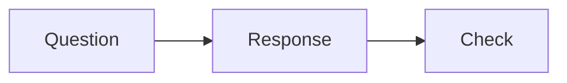

# 作者与译者指南

课程只从 `content/<lang>/` 编译。网站页面无需逐篇修改。当前产品行为见 [需求说明](./requirements.md)，数据流见 [架构说明](./architecture.md)。

## 本地启动

使用 Node 22.17.0 或更新的 22.x 补丁版本与 pnpm 10.30.3，执行 `pnpm install --frozen-lockfile`。`pnpm dev` 与部署展示同一份课程。新增文件、修改 frontmatter 或 meta 后重启开发服务以刷新公开清单；正文编辑支持热更新。

`CONTENT_TEST=1` 仅用于非公开工程验收，连接 Vercel 时会直接拒绝启动。

开发服务使用 Webpack，以避免 Turbopack 热更新时丢失 CSS 分块。更新启动命令后，重启 `pnpm dev` 并刷新浏览器一次。外链页面拒绝抓取或没有可用元数据时，预览接口返回空内容，卡片显示不可预览提示；这不影响点击跳转。本机 DNS 代理返回虚拟 IP 时，服务通过 Cloudflare HTTPS DNS 查询真实地址，并继续拦截内网地址。

## 新增原文课程

1. 在 `content/zh/<course>/` 建立目录，复制 [课程模板](./templates/course-original.mdx) 为 `index.mdx`。更换所有示例文字与 ID；课程原文也可以使用其他受支持语言。
2. 填写 `sourceLocale`、本语言标题、简介、难度、目标 `goals`、受众 `audience` 和前置要求 `prerequisites`。课程总览由这些字段和课时目录生成，课程文件无需正文。写入 `content/` 并列入 `meta.json` 的文件即公开。
3. 为课程与每一层模块新增 `meta.json`，在语言根 meta 的 `pages` 中加入课程目录。每层 `pages` 只写直接成员的 ASCII 文件名或目录名，不带扩展名。
4. 从 [课时模板](./templates/lesson-original.mdx) 新增课时。`courseId` 匹配课程，`lessonId` 永久代表这一逻辑课时；修改标题、排序或路径时保留 ID。
5. 在模块 meta 中按教学顺序列出课时。课程 meta 包含 `index` 和各模块。不要通过文件名排序、通配符或数字前缀推断顺序。

```json
{
  "title": "Foundations",
  "pages": ["first-change", "useful-context"]
}
```

课程介绍不计入课时数量。课程可以先发布介绍，再逐步添加课时。没有课时的课程保留首页卡片和总览，显示「内容更新中」，不显示开始第一课或课时统计。完全没有课程的语言会显示本地化空状态。

## 编写与检查

正文使用 `==text==` 添加淡黄色荧光笔式高亮。笔触边缘略有起伏，并保留轻微叠色与笔痕；底色只覆盖文字中下部，文字颜色、字号和字重保持原样。可包住强调、链接和标题文字，也可用于 `JimmyNote` 等组件的正文。内容换行时，每一行都会保留背景。无需 import，也无需手写 `<mark>`。

```mdx
Use ==a key point== in a paragraph.
Combine ==**bold** and *emphasis*== when needed.
```

行内代码和围栏代码里的 `==text==` 保持原样；写成 `\==text==` 可显示字面的等号。未闭合的标记保持普通文本。成就选项仍使用纯文本标签。

正文支持 LaTeX 数学公式：行内使用 `$y = ax + b$`；独立公式的前后 `$$` 各占一行。支持分数、上下标、求和、矩阵，以及 `aligned` 多行公式。公式在编译时排版，无 JavaScript 也可阅读，同时提供供辅助技术读取的 MathML；样式和字体均从本站加载。长独立公式在自己的区域内横向滚动，不会撑宽文章。

```mdx
Use $y = ax + b$ in a paragraph.

$$
y = ax + b
$$

$$
\frac{1}{n} \sum_{i=1}^{n} x_i
$$
```

普通价格写成 `\$10`，避免美元符号被识别为公式。行内代码、普通围栏代码及转义的美元符号保持原样；未闭合的行内公式保持普通文本。无效 LaTeX 会使内容检查或编译失败，错误包含文件、公式起始行列和原因。不支持完整 LaTeX 文档、公式自动编号、交叉引用或自定义宏配置。可在 [公式预览](http://localhost:3000/design/components#math) 检查显示。

普通 Markdown 页面链接自动支持预览，无需添加组件或 import。鼠标悬停 350ms 或键盘聚焦后显示标题、摘要、域名和可用的封面；鼠标移入卡片后保持显示，Escape 关闭。站内已发布课程和课时使用本地标题与简介；外部 HTTPS 链接按需读取页面元数据并缓存。未提供元数据或读取失败时显示域名与提示，链接仍可打开。触屏点击和无 JavaScript 时直接跳转。同页锚点、邮件和下载链接保留原行为。可在 [链接预览](http://localhost:3000/design/components#link-previews) 检查效果。

使用独立的 `<XEmbed url="..." />` 嵌入单条公开 X 帖子，使用 `<YouTube url="..." />` 嵌入单个 YouTube 视频。两个组件均无需 import，只接受必填的静态 `url` 与可选的非空 `title` 字符串，不接受子内容，不能放在行内。可在 [嵌入预览](http://localhost:3000/design/components#embeds) 检查显示。普通链接继续显示链接预览，不会自动转换为播放器。

```mdx
<XEmbed url="https://x.com/API/status/133640144317198338" />

<YouTube
  url="https://youtu.be/M7lc1UVf-VE?t=1m30s"
  title="YouTube player demonstration"
/>
```

X 接受 `x.com` 和 `twitter.com` 的帖子链接，包括移动端域名与 `/i/status/`、`/i/web/status/` 格式。YouTube 接受 `youtube.com/watch?v=...`、`youtu.be/...`、`youtube.com/shorts/...` 和 `/embed/...`，也接受隐私增强域名的 `/embed/...`。链接必须使用 HTTPS，不得包含账号、密码或非标准端口；不支持个人主页、时间线和播放列表。起始时间优先读取 `start`，其次是 `t` 查询参数，最后是 `#t=`；支持整数秒与 `1h2m3s` 格式。其他分享参数不会传入播放器。

X 使用官方组件，在接近视口时加载，全页共用一次脚本。脚本加载最多等待 10 秒，单条帖子整体最多等待 15 秒；失败时显示本地化提示。YouTube 使用隐私增强播放器，延迟加载，不自动播放，支持全屏与移动端内联播放；窄屏保留至少 200px 高度。X 仅在加载失败或无 JavaScript 时显示原站链接；加载成功后使用帖子自带的查看入口。YouTube 始终保留原站链接。嵌入会直接连接相应平台，受平台隐私政策及可用性影响；隐私增强模式不表示完全没有网络请求或跟踪。构建不请求平台接口，也不需要 API 密钥。

标题从 frontmatter 渲染为唯一 h1，正文从 `##` 开始。支持普通 Markdown、表格、围栏代码、图片，以及 `Callout`、`JimmyNote`、`JimmyNoteAnchor`、`KeyTakeaway`、`Chat`、`ChatMessage`、`ChatThinking`、`ChatToolCall`、`InlineCitation`、`ChatMessageSequence`、`XEmbed`、`YouTube`、`Steps`、`Step`、`LLMGenerationDemo`、`MenuComparisonDemo`、`TokenizationDiagram`、`TokenProbabilityDiagram`、`LLMPretrainingOverview`、`LLMSingleRoundTrainingDemo`、`LLMMultiRoundTrainingDemo`、`Achievement`、`AchievementOption`。`.md` 与 `.mdx` 均通过统一 MDX 管线，同路径只能保留一种扩展名。

使用 `mermaid` 代码围栏绘制流程图、时序图等图表，无需 import。图表使用 [Pele](https://pele.run/) 在服务端生成 SVG，不向浏览器加载图表引擎。图表沿用站点字体与颜色；宽图保持文字大小，在图表区域内横向滚动，支持键盘操作、放大文字和无 JavaScript 阅读。通过 `accTitle` 与 `accDescr` 提供图表标题和说明。可在 [组件预览](http://localhost:3000/design/components#mermaid) 检查效果。

````mdx

````

`pnpm content:check` 会校验 Mermaid 语法，并报告原文件与围栏行号。使用 `text` 围栏展示源代码。Pele 使用自己的布局，支持范围见 [兼容说明](https://pele.run/compatibility)；Mermaid 主题、HTML 标签和外部插件不适用。图内链接和图片不启用；请在正文中提供链接和图片。`MermaidDiagram` 是编译器内部组件，源文不接受该组件。

```mdx
<Callout title="Check the result" type="info">
Read the diff and verify the actual behavior.
</Callout>
```

`JimmyNote` 用于与原文关联的个人观察或补充说明。用行内 `JimmyNoteAnchor` 包住原有文字，再用独立的 `JimmyNote` 提供批注；两者通过相同的 `id` 和 `anchor` 配对。标识使用小写英文字母、数字和连字符，同一篇文章内必须唯一且一一对应；文字锚点和批注都必须有文字；图片锚点必须包含一张带有有效替代文本的 Markdown 图片。文字锚点显示浅橙色高亮，不加下划线。可用文章容器达到 64rem 时，批注显示在 21rem 右栏。高亮末行右下角的橙色圆点，经约 12px 短斜线后水平接入卡片左边缘的设定偏移位置。卡片使用直角、白底、同色边框及浅橙色偏移阴影；边框和连线共用 1.5px 线宽，并按浏览器实际边框像素对齐。卡片按原文顺序至少间隔 16px；密集批注的连线先从行间进入栏间空隙，再连接卡片，避免穿过文字。右侧批注与独立左侧目录互不占位，正文和右栏布局保持稳定。空间不足时，高亮末尾显示无底色的数字上标，点击打开浮层。编译时按正文锚点的出现顺序自动生成 1、2、3 等编号，图片锚点也参与排序；每篇文章从 1 开始，即使批注块写在锚点前面，编号仍按锚点顺序排列。数字只显示在批注入口；展开后的卡片和无 JavaScript 备注不在 Jimmy 署名旁重复显示编号，但为屏幕阅读器保留对应编号的说明。可见编号在各语言中统一使用数字，按钮和批注的无障碍说明由 UI 字典本地化。上标保留至少 44px 的点击区域，支持键盘打开、Escape 关闭和焦点返回。无需手写编号；`noteNumber` 是编译器内部属性，源文不接受该属性。头像、Jimmy 署名和「本文作者」说明自动提供，右侧依次显示 Star、小红书、X、哔哩哔哩和公众号二维码五个无边框图标。前四个链接复用站点作者配置；二维码支持悬停或点击查看，暂时复用作者弹窗中的占位内容。桌面图标保持紧凑并与作者信息同排居中；浮层中图标换行后与头像左边缘对齐。触屏点击区域至少为 44px。按 Escape 关闭二维码浮层后仍保留原批注，并返回二维码按钮；点击两层浮层外部时一并关闭。内容支持多段 Markdown、强调、高亮、公式和链接。禁用 JavaScript 时，批注完整显示在原位置。无需 import，可在 [组件预览](http://localhost:3000/design/components#jimmy-notes) 检查效果；通过 `?lang=en`、`?lang=ja`、`?lang=fr` 或 `?lang=es` 可切换交互控件的语言，示例正文保持原文。

```mdx
Read <JimmyNoteAnchor id="context">this text</JimmyNoteAnchor>.

<JimmyNote anchor="context">
Add a personal observation here.

Use **emphasis** and [links](https://example.com) when useful.
</JimmyNote>
```


Use `variant="image"` on a standalone `JimmyNoteAnchor` to attach a note to an image. Keep exactly one Markdown image or image reference inside the anchor. The image retains its original alt text and appearance. Wide layouts connect the midpoint of its right edge to the note’s left border at the configured inset; narrow layouts show a numbered marker inset 12px from the image’s top and right edges, with a light backplate for contrast and a 44px minimum target. Without JavaScript, the note stays readable after the image.

```mdx
<JimmyNoteAnchor id="illustration-credit" variant="image">


</JimmyNoteAnchor>

<JimmyNote anchor="illustration-credit">
Thanks to [ian-xiaohei-illustrations](https://github.com/helloianneo/ian-xiaohei-illustrations) for the illustration tools.
</JimmyNote>
```

`KeyTakeaway` 用于「划重点」，突出读者需要记住的结论。它保留引用块的黑色直角外框、偏移阴影和完整正文宽度，上边框嵌入固定标签，标签随界面语言切换。正文支持多段文字、强调、高亮、列表、行内代码和链接，无需 import 或 JavaScript。组件必须独立成块且包含文字，不接受参数；不要把它放进行内文字中。可在 [划重点预览](http://localhost:3000/design/components#key-takeaways) 检查效果。

```mdx
<KeyTakeaway>
**Keep a source for claims that need to be accurate.**
</KeyTakeaway>
```

`ChatMessage` 用于文章里的静态对话示例，参考 [shadcn Message](https://ui.shadcn.com/docs/ai-elements/radix/message) 的布局。组件复用引用块的黑色直角边框和右下偏移阴影，并保留内边距；`from="user"` 显示右侧灰色气泡及圆形用户图标头像，`from="assistant"` 显示左侧浅色描边气泡及机器人头像。两种头像共用浅灰底和灰色图标。头像随消息角色自动显示，无需配置图片。正文支持多段 Markdown、强调和链接，无需 import 或 JavaScript。

用 `<Chat>` 包住多条消息，可在同一个外框里展示完整对话；单独使用 `ChatMessage` 时会显示自己的外框。

```mdx
<Chat>
<ChatMessage from="user">
What is an LLM?
</ChatMessage>

<ChatMessage from="assistant">
An LLM generates text from the context you provide.
</ChatMessage>
</Chat>
```

`ChatMessage` 的 `state` 配置决定显示状态。默认 `state="complete"` 显示正常回复气泡；`from="assistant" state="thinking"` 使用 [shadcn Radix Reasoning](https://ui.shadcn.com/docs/ai-elements/radix/reasoning) 的官方 `TraceLine`，以 running 状态显示旋转指示和 Thinking 文字，保留 LLM 头像。它不带消息气泡，也不接受正文，只展示文章里的思考状态示意，不调用模型。系统开启减少动态效果时停止旋转；无 JavaScript 时仍可阅读。

```mdx
<Chat>
  <ChatMessage from="user">What is an LLM?</ChatMessage>
  <ChatMessage from="assistant" state="thinking" />
</Chat>
```

要展示已完成的思考内容，在 assistant 的完整回复内添加一个独立块 `<ChatThinking>`。标签内写思考正文，标签外写最终回答。它按官方 Reasoning 用 `TraceCollapsible` 展示完成图标和 Thought 文字；思考区默认收起，可用 `defaultOpen={true}` 或 `defaultOpen` 配置为展开，用 `defaultOpen={false}` 明确配置为收起；读者可点击标题或使用键盘切换，与最终回答共用一个头像。正文支持多段 Markdown、强调、链接和行末 `\` 换行。无 JavaScript 时使用遵循相同初始配置的原生 details，仍可折叠和阅读。下方展示的是作者配置的教学示例，不调用模型。

```mdx
<ChatMessage from="assistant">
<ChatThinking defaultOpen={true}>
Break it down.\
37 × 48 = 37 × (50 − 2) = 1776
</ChatThinking>

The answer is **1776**.
</ChatMessage>
```

`ChatToolCall` 用于已完成的工具调用示例，直接放在 assistant 消息内，与最终回答共用一个头像。必填的静态 `name` 表示工具名称，`title` 表示读者看到的操作名称。按 [shadcn Radix Tool](https://ui.shadcn.com/docs/ai-elements/radix/tool) 使用官方 `Trace` 和 `TraceCollapsible`，以工具图标、标题和折叠箭头组成紧凑的一行，默认收起工具名称和正文；`defaultOpen={true}` 或 `defaultOpen` 可配置为展开，`defaultOpen={false}` 可明确配置为收起，读者仍可自行切换。完成说明随可访问名称本地化。正文可用 Markdown 和代码围栏展示调用参数、返回结果；代码围栏转换为官方小尺寸 `CodeBlock`，支持长内容换行。无需 import，也不会执行搜索。Radix 折叠支持鼠标和键盘；无 JavaScript 时以遵循相同初始配置的原生 details 显示相同内容。收起时保留最终回答，可以与 `ChatThinking` 或其他工具调用块一起使用。可在 [工具调用预览](http://localhost:3000/design/components#chat-tools) 检查效果。

```mdx
<ChatMessage from="assistant">
<ChatToolCall name="search_web" title="Search the web" defaultOpen={true}>
Search query: Guangzhou weather forecast for tomorrow.

Result: Light rain, 23–28 °C.
</ChatToolCall>

The forecast is light rain, 23–28 °C.
</ChatMessage>
```

`InlineCitation` 在句子中插入来源标签，按 [shadcn Radix Inline Citation](https://ui.shadcn.com/docs/ai-elements/radix/inline-citation) 组合官方 `HoverCard` 和 `Button`。必填 `url` 是不含凭据的完整 HTTPS 地址；可选 `title` 和 `description` 提供来源标题和摘要，传入时不能为空。组件只接受静态字符串，不接受子内容或独立块。悬停或键盘聚焦显示作者填写的来源信息，点击标签直接在新标签页打开原站；触屏一次点击和无 JavaScript 时的原生链接仍可用。控件说明支持五种语言，不抓取远程元数据。可在 [行内引用预览](http://localhost:3000/design/components#inline-citations) 检查效果。

```mdx
<ChatMessage from="assistant">
The forecast is available on the source page. <InlineCitation url="https://www.weather.com.cn/weather/101280101.shtml" title="Guangzhou forecast" description="Check the forecast date and weather conditions." />
</ChatMessage>
```

`ChatMessage` 接受必填的静态 `from="user"` 或 `from="assistant"`，以及可选的 `state="complete"` 或 `state="thinking"`；thinking 只用于 assistant。`ChatThinking` 仅接受可选的布尔值 `defaultOpen`，只能直接放在 `state="complete"`（默认值）的 assistant 消息内，且每条消息最多一个，正文不能为空。`ChatToolCall` 也只能直接放在完整回复状态的 assistant 消息内；`name`、`title` 和正文均不能为空，可选 `defaultOpen` 配置初始展开状态，不接受其他属性或行内使用。`Chat` 不接受参数；`Achievement` 和 `AchievementOption` 的字段见下方「文章成就」；`XEmbed` 和 `YouTube` 仅接受上方说明的 `url` / `title`；`InlineCitation` 仅接受 `url` / `title` / `description`。其他组件只允许静态 `title` / `type` 字符串。仅 `ChatThinking` 和 `ChatToolCall` 的 `defaultOpen` 接受布尔字面量 `{true}` / `{false}` 或无值属性；禁止 import、其他 JavaScript 表达式、原始 HTML、iframe、脚本和未知组件；`mermaid` 围栏生成静态图表，其他代码围栏里的示例不会执行。注册入口为 `src/components/mdx/components.tsx`，不要为了单篇文章绕过校验器。

本地图片放到 `public/images/`，正文使用有意义的本语言 alt。编译器从图片读取宽高。这里的素材任何人都能访问，不能存放密钥或未公开的敏感素材。

```md

```

站内链接使用最终公开路径或当前文章 `#heading`。英文使用 `/courses/...`，其他语言保留前缀，如 `/zh/courses/...`；禁止在正文链接中使用 `/en` 别名。课时公开地址不含模块，例如 `/zh/courses/llm-101/strengths`；同一课程内课时 slug 必须唯一。跨语言链接文字必须包含目标语言自称，例如 `[English: What AI is good at](/courses/llm-101/strengths)`，且目标文件已经存在。不可链接不存在的课时或锚点。课程总览只渲染元数据和目录，支持 `#course-catalog`；课程介绍正文中的标题不会渲染，不能作为锚点。课程列表位于语言首页，`/{lang}/courses` 不存在。外部资料可用 HTTPS 链接；X 帖子与 YouTube 视频可使用专用嵌入组件。

文章 frontmatter 只填写 `courseId`、`lessonId`、`title` 和 `description`。标题不含手写课时序号；课程目录与 Sidebar 按模块和课时顺序自动生成 `01`、`02` 等模块编号，以及 `1.1`、`2.1` 等课时编号。调整 `meta.json` 顺序后，编号随目录更新，无需修改文章。`lessonId` 是稳定身份，修改标题或文件名时保持不变。类型由文件位置自动推导：课程根目录的 `index.mdx` / `index.md` 是课程介绍，其他已排序文章是课时。不要手填 `kind`，也无需维护阅读时长、文章分类、验证日期或修订版本。

```bash
pnpm content:check
pnpm i18n:check
pnpm check
pnpm build
```

这些命令校验全部文件的格式、身份、目录和字典，并验证课程引用。错误会带文件路径；缺译文是正常状态。

## 新增译文

在目标语言建立相同课程、模块与课时路径，复制 [课程译文模板](./templates/course-translation.mdx) 和 [课时译文模板](./templates/lesson-translation.mdx)。保留原文的 `courseId`、`lessonId`、`sourceLocale` 和 ASCII 路径；翻译标题、正文、简介、目录名称、alt 与相关 UI 内容。

目标语言 meta 只列已有文件，顺序是原文顺序的子序列。系统按稳定身份关联译文，不使用人工修订号判断内容是否同步。

缺译文的课时不存在，不复制原文到另一种语言目录冒充译文。切换菜单会明确说明将前往目标语言课程总览或首页。

原文更新后由作者核对译文。站点不显示译文版本提示；修改正文不重置阅读记录或成就。

## 发布、下架与改 URL

课程文件列入对应 `meta.json` 后即公开。检查 meta 完整，执行 check / build / 生产 E2E。请按 [部署指南](./deployment.md) 发布通过检查的提交。

下架时删除该语言的文件，并同步删除仍引用它的译文；目录中不再保留已删除的条目。原文文件不能在译文仍引用时直接移除。没有课时的课程介绍可以继续公开，并显示内容更新状态。

已发布 URL 变化时同步所有语言的相对路径，保持稳定 ID，并在 `config/redirects.json` 添加旧 URL 到实际公开新 URL 的映射。不能有链式跳转、环、动态匹配或外部目标。

```json
[
  {
    "source": "/courses/llm-101/old-name",
    "destination": "/courses/llm-101/strengths"
  }
]
```

上面的 JSON 只说明字段形状。真实迁移写在 `config/redirects.json`，目标必须已经公开。只有发生 URL 迁移时才追加条目，不要用示例覆盖现有映射。

## 互动需求

中文版「AI Chat 实用技巧」在「一、多用 Artifact 功能」使用 `<NewtonSecondLawDemo />` 直接解释牛顿第二定律。组件无参数、无子内容，无需 import。顶部展示 F = ma、加速度 = 合力 ÷ 质量及同步更新的数值算式。读者可调节 0–8 N 的合力和 1–4 kg 的质量；重点反馈合力加倍时加速度加倍、质量加倍时加速度减半。两辆小车从静止开始，在无摩擦水平面上持续受力 2 秒；对照固定为 4 N、2 kg。位置按 s = at²/2、速度按 v = at 计算，使用相同空间与时间尺度。支持开始对比、暂停、继续、重置，改参数会返回起点；离屏或切至后台时暂停。减少动态效果模式直接展示 2 秒后的结果；无 JavaScript 时保留公式与控制变量的结论。沿用站点黑白配色、引用边框、偏移阴影及按钮，不请求外部接口，也不写入学习进度。

中文版「AI Chat 是如何工作的？」在寄信类比段落后使用 `<ChatMessageSequence />`。这是无参数、无子内容的独立块，无需 import。组件进入可视区域后，先演示直接发送文本被服务器拒绝，模型未调用；再演示格式正确的 JSON 请求、模型生成回复、服务器返回 JSON、产品提取文本后呈现给用户。格式错误与正确分别用红叉和绿勾标识。消息气泡悬浮在当前箭头旁，尖角指向实际线条中点，不撑高图表；窄屏和放大字体时重新测量位置。演示播放一次后停止，支持暂停、继续和重新演示；离开可视区域或切到后台时暂停。仅切换离散步骤，不产生连续位移动画。无 JavaScript 时静态展示两次尝试的完整过程。内容为本地教学示例，不调用模型，也不写入学习进度。

中文版「模型是如何预训练的？」在「预训练的大致流程」使用 `<LLMPretrainingOverview />`。它是无参数、无子内容的独立块，无需 import。顶部三个 tab 分别切换筛选清洗、Token 编码和预测训练的手绘图片，支持鼠标指针、方向键、Home 和 End。三张图片共用固定 16:9 区域，预先加载，切换时不改变内容高度；点击或用键盘打开图片可以放大查看，Escape 关闭并返回原控件。素材位于 `public/images/courses/how-language-models-are-trained/`，PNG 原图和生图提示词位于 `assets/how-language-models-are-trained-illustrations/`。Token 图片沿用 `<TokenizationDiagram />` 的天气问题、六组词元及 ID，替换文字说明从共享数据生成；修改该示例时必须同步图片。预测训练图片保留「预测下一个 Token → 对照原文 → 调整参数」及返回预测的循环。组件复用训练图解的直角边框，不增加标题或脚注；无 JavaScript 时依次显示三张图片及步骤名称，不读写学习进度。

中文版「模型是如何算出 Token 概率的？」在「从简单类比到真实模型」末尾使用 `<TokenProbabilityDiagram />`。组件是无参数、无子内容的独立块，无需 import。它静态展示「今天下雨，出门记得带…」→ 大量相互连接的计算 → 多个分数 → 对应的「伞、雨衣、帽子」等候选 → 按采样策略选择一个 Token ID，并以「伞」作为结果示例。计算网络从上向下展开，分数与候选逐列对齐，全部候选通过曲线汇入同一个采样步骤。分数编号是示意标签，不虚构实际词表 ID；分数转概率已在上文讲解，图中不另设阶段。复用引用黑框、浅灰输入和采样背景，不增加标题、脚注、动画或操作按钮。服务端完整渲染，窄屏、放大字体和无 JavaScript 时均可阅读。

中文版「模型是如何预训练的？」使用 `<LLMSingleRoundTrainingDemo />`，展示 00 初始化、01 预测、02 对照、03 调参数，沿用正文的「y = ax + b → 分数 → Softmax → 概率」类比。初始化只展示「伞、雨衣、帽子」各自的 a、b，不显示输入、分数、概率或正确答案；点击「开始预测」后展示「今天雨天，出门记得带…」，将下雨简化为固定的 x = 1。对照步骤在输入旁揭晓原文答案「伞」，保留原模型数值。调参数步骤保留左侧原模型，在右侧新增调整后的模型，突出 a、b 的变化；窄屏上下排列。「伞」的 a、b 从 0.50、1.10 调整为 0.60、1.20，分数从 1.60 变为 1.80。分数和 Softmax 概率由教学参数实际计算，显示为两位小数与整数百分比。不显示底部解释栏，步骤提示仅供屏幕阅读器使用。02 对照在「伞」的概率旁显示中文手写旁注与手绘箭头，解释原文答案和 25% 预测概率之间的差距；仅这一页显示，窄屏与放大字体时在概率条上方顺序排列，避免遮挡公式。手写字体为本地 WOFF2 子集，首次显示旁注时加载，授权文件与字体一同保留。随后用 `<LLMMultiRoundTrainingDemo />` 展示同一输入和候选的多轮概率记录，「伞」依次为 25%、45%、60%、72%，前两组分布与单轮模型共用数据。两者都是独立、无参数、无子内容的块级组件，无需 import；不请求模型或网络、不记录学习进度。共用引用边框、按钮和输入展示，不显示组件标题、训练原文块或示意脚注。一轮版支持上一步与返回初始化，两者均支持重新演示和无 JavaScript 静态阅读。

中文版「什么是 Token？」在编码说明后使用 `<TokenizationDiagram />`。组件不接受参数，无需 import。它静态展示天气问题经过 Tokenizer 切分成 6 个词元、映射为文中对应的 Token ID，再以数组 `[47256, 132426, 1616, 167823, 24608, 4802]` 按原顺序送入 LLM；随后展示模型输出 Token ID 数组 `[47256]`、经 Tokenizer 解码为「今天」、呈现给用户的过程。列数随容器宽度和读者字体大小调整；无 JavaScript 时仍完整显示。

该文在 Token 与字词边界的补充说明之后、实际用途之前，通过 `<Achievement>` 声明「看懂 Token 的边界」，稳定 ID 为 `token-boundaries`。三项单选用于区分完整字词、文本片段和不同 Tokenizer 的差异；答对后与第一课的成就一起计入课程进度，无需手动修改总数。

中文版「What a language model does」使用 `<LLMGenerationDemo />` 展示固定虚构回答的自动逐字生成过程，使用 `<MenuComparisonDemo />` 比较原生选择控件与 shadcn 风格菜单。这两个组件不接受参数，无需 import，也不调用模型或外部接口。生成演示逐轮显示完整输入和候选概率，再展示按概率采样的固定结果（包含未选中最高概率候选的轮次），将选中的 Token 接入下一轮输入，再向上换行。顶部仅保留「预测概率 → 按规则选择 → 继续生成」，不显示第二行动态说明或底部解释段落；演示以单字简化 Token，候选、概率、采样结果和天气均为固定的虚构示例。组件内提供暂停、继续播放和重新播放；离开可视区域或切换到后台时暂停计时，减少动态效果模式下直接显示完整结果，无 JavaScript 时提供可展开的静态说明。菜单比较使用与作者注释相同的直角边框和右下偏移阴影，上边框嵌入「试一试」文字，不显示头像；两个按钮仍等宽居中。菜单支持键盘操作和独立的选择反馈，无 JavaScript 时仍显示边框、标题和原生菜单。中文版 `what-a-language-model-does.mdx` 在文章末尾通过通用 `<Achievement>` 声明「把需求说清楚」，稳定 ID 为 `input-shapes-output`。三项单选引导读者补充使用场景、交互要求和参考示例，而不是依赖模糊要求或角色指令保证结果。「分清生成与查证」使用稳定 ID `generation-vs-verification`，位于 `how-language-models-are-trained.mdx`。两项成就均使用课程命名空间内独立的存储键。

### 文章成就

新增成就只需在文章 MDX 中填写题目和选项，无需修改 TSX、注册组件或维护成就总数。开发环境修改成就声明后会热更新；文章定义与课程成就清单在请求中读取最新内容并统一校验，无需重启 `pnpm dev`。生产环境仍使用构建时生成的清单。

```mdx
<Achievement
  id="check-the-source"
  title="Source checker"
  question="The model has no live weather data. What can you conclude?"
  answer="verify"
  explanation="Specific details do not prove a weather lookup."
  takeaway="Check the source before trusting the numbers."
>
  <AchievementOption value="trust">It knows the current weather.</AchievementOption>
  <AchievementOption value="verify">The weather still needs checking.</AchievementOption>
</Achievement>
```

题目直接显示 `question`，不需要额外的标题字段；`title` 仅用作解锁后的成就名称。所有字段均为必填的静态非空字符串。`id` 和选项 `value` 使用小写 ASCII 单词及连字符；同一课程内 `id` 唯一。至少提供两个不同 `value` 的选项，`answer` 必须匹配其中一个。选项仅支持纯文本，字母序号由组件自动生成。不要手填序号、使用表达式或添加自定义 JSX；校验会拒绝不完整、重复或无正确答案的题目。只能放在课时文章中，不能放在不渲染正文的课程介绍中。

原文定义决定课程成就清单和 Sidebar 圆环的总数。译文可以暂不加入题目；加入时必须放在对应课时，保留相同的 `id`、选项 `value` 和 `answer`，只翻译展示文本。同一课程跨语言共享数量。标题、URL 和选项顺序改变不影响解锁记录；发布后不要复用或随意更换成就 ID。

挑战以「🥇 成就挑战」和 `question` 开始。答错显示带错误图标的「回答不正确」与 `explanation`，允许重新选择。答对自动记录成就并更新 Sidebar，立即显示只包含成就名称 `title`、`takeaway` 和「再试一次」按钮的成就卡片，无需额外点击。解释只在答错或无 JavaScript 的展开说明中显示。成就卡片提供「再试一次」：清空本次选项与反馈，将焦点放回答题选项，允许再次答错或答对。重试不撤销成就、不修改首次解锁时间，也不增加统计。已解锁后刷新直接显示成就卡片。界面提示有五语字典。刷新恢复、同源标签页同步、存储失败时的页面内保存和减少动态效果设置均由通用组件处理。无 JavaScript 时显示问题与可展开的解释，不能解锁或保存。

「再试一次」显示为成就标题首行最右侧的回转箭头图标，保留本地化的无障碍名称和悬停提示。每次主动答对，包括重试答对，都会从屏幕左右底角连续三波向上撒花，约三秒后结束。桌面共 240 片、窄屏共 160 片，使用八种鲜亮颜色和不同大小的方片、圆片与彩带，喷射范围覆盖屏幕中上部。答错、刷新恢复与标签页同步不播放；系统启用减少动态效果时也不播放。重试、离开页面或切换到减少动态效果会清理动画。这些行为由通用组件提供，不需要增加 MDX 参数。

计分考试、自建视频播放器、其他交互练习和提示词对比暂不实现。现有组件不足时，先记录真实材料、输入、状态、失败处理和验收条件，并更新 [需求说明](./requirements.md)。不要提前创建空组件。

## LLM 101 的课程范围

LLM 101 是无需编程或训练经验的入门课程。当前发布五语课程介绍、十三节中文正文与其他语言的第一课欢迎占位文档。课程介绍位于 `content/<lang>/llm-101/index.mdx`，已有课时按下面三个模块组织。

| 模块目录 | 模块名称 | 已发布课时 |
| --- | --- | --- |
| `model-fundamentals` | 大语言模型的工作原理 | 1.1 生成回答；1.2 Token；1.3 采样与回答的随机性；1.4 从参数与候选分数理解 Token 概率 |
| `model-training` | 模型的训练与能力 | 2.1 模型是如何预训练的；2.2 模型的「深度思考」是怎么回事；2.3 模型是如何看图和听声音的；2.4 开源模型、参数量与本地运行；2.5 如何选择适合自己的大语言模型 |
| `ai-applications` | AI 应用的工作原理 | 3.1 AI Chat 是如何工作的；3.2 Tool 是什么；3.3 使用 AI Chat 的几个建议；3.4 AI Chat 实用技巧 |

02 用五篇文章连接预训练、深度思考、多模态输入、开源模型与本地运行和模型选择，不安排后训练、强化学习或训练算法的深入教程。2.2 通过预算题的教学草稿解释推理、展示摘要和计算成本，并声明草稿不是实际模型的 Thinking 记录；补充固定网络层数与中间 Token 带来的计算轮次，介绍 test-time scaling 的串行推导、候选筛选与过度思考限制。2.3 通过编码器类比解释图像特征、语音转写与音频理解，区分输入和输出能力。两篇都保留实际用途与独立成就，稳定 ID 分别为 thinking-is-not-verification、distinguish-audio-inputs。2.4 将原选型课中关于开源与闭源、参数量、MoE 和本地运行的问题独立成课，保留原文、公式与批注；2.5 保留模型评测、选型与练习，原 slug 与成就 ID 不变。

所有模块用自己的 `meta.json` 排序。其他语言已有的第一课同步放入 `model-fundamentals`，保持译文路径与中文原文一致；没有译文的模块不创建空目录。公开 URL 不包含模块目录。各课保留稳定的 `lessonId`、slug 和成就 ID；仅移动模块不需要重定向，也不改变学习记录。首页「马上学习」仍按 `meta.json` 的顺序进入第一课。`tests/fixtures` 中的 `ai-coding` 只用于工程验证，不属于公开课程。

### 03 的后续写作方向

下表是写作规划，3.1 至 3.4 已发布，其余尚未发布。只有完成正文后才加入 `meta.json`；不创建空课时或指向未发布内容的链接。

每篇采用「实际问题 → 简单原理 → Chat 操作练习 → 检查结果」的顺序。使用方法放在对应教程中，避免单独重复一套产品使用手册。具体产品的按钮、配额或界面操作以写作时的实际产品为准。

| 课时 | 主题 | 对应的 Chat 使用练习 |
| --- | --- | --- |
| 3.1 | AI Chat 是如何工作的 | 在同一对话和新对话中提问，对比哪些历史信息进入输入 |
| 3.2 | Tool 是什么 | 查询天气并检查调用记录、预报日期、来源和返回结果；成就 ID 为 `tool-request-vs-execution` |
| 3.3 | 使用 AI Chat 的几个建议 | 通过尝试、补充上下文、引导提问和复述来改进回答，认识能力边界；保留成就 ID `use-chat-with-source-material` |
| 3.4 | AI Chat 实用技巧 | 生成交互教程或数据看板，描述交互要求、逐步修改并核对结果；保留牛顿第二定律演示 |
| 3.5 | 提示词如何影响回答 | 写清目标、对象、限制和示例，比较输出并修改要求 |
| 3.6 | 上下文与记忆 | 判断何时继续对话、何时新建对话，以及如何保存必要背景 |
| 3.7 | 文件、知识库与 RAG | 上传资料并要求引用原文，核对回答是否有依据 |
| 3.8 | MCP | 理解应用如何连接外部工具与资料，在支持的产品中检查连接与授权 |
| 3.9 | Skills | 理解可复用的任务指令、资料和脚本，尝试安装或使用一个适合任务的 Skill |
| 3.10 | 从 AI Chat 到 Agent | 区分一次回答与连续执行，认识 Agent 的目标、工具、检查与停止条件，为 Agent 101 建立前置概念 |

权限、敏感资料、来源核对和结果验证随练习一起讲解。MCP、Skills 和工具调用分别解释职责，不画成必须依次安装的层级。

### Agent 101 的课程边界

Agent 101 规划为独立中级课程，目前未创建或发布。前置能力是理解模型生成、上下文、工具调用，以及 LLM 101 的 3.10；不要求学习后训练。

建议围绕 ReAct loop、运行状态与停止条件、Coding Agent 的代码阅读与修改、终端工具与 E2E 验证、上下文管理、失败恢复和权限边界展开，以完成可验证的任务为目标。ReAct loop 是推理与行动交替的模式，不是 React 前端框架。MCP 与 Skills 的基础概念留在 LLM 101，在 Agent 101 中讲如何把它们用于持续执行的工作流。
